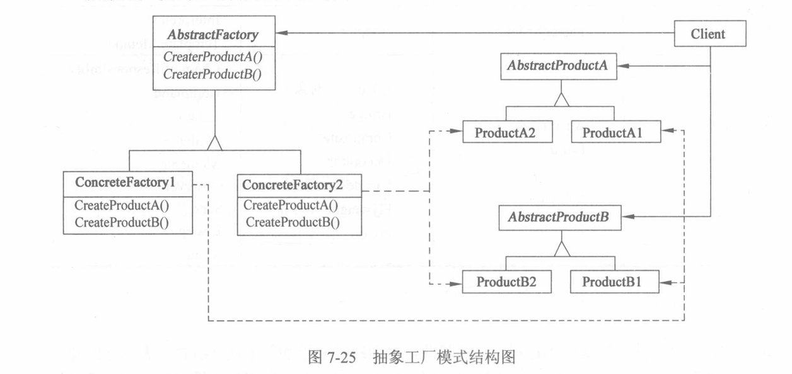
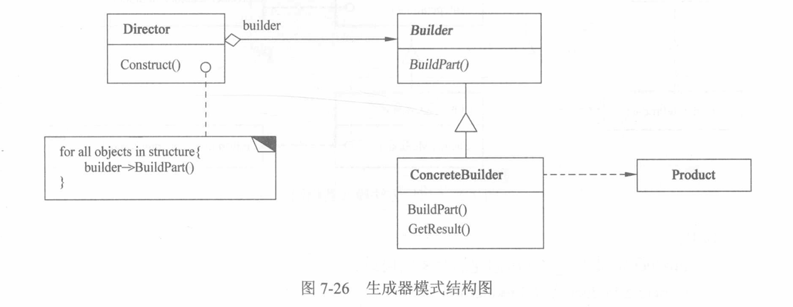
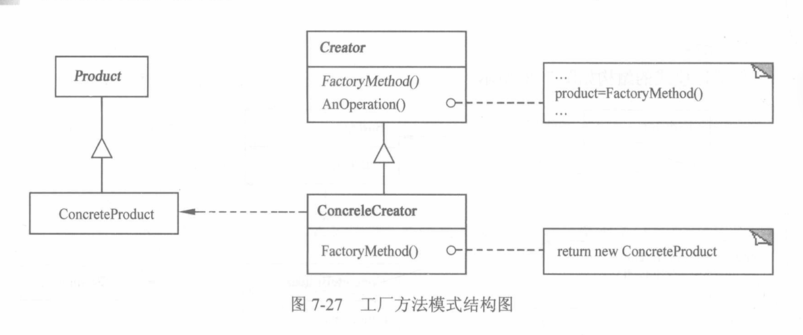
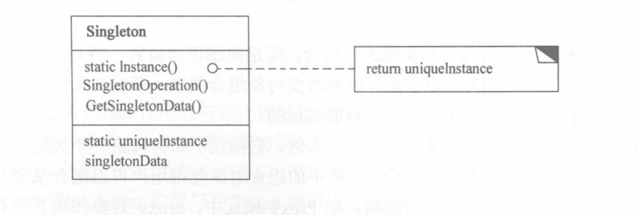
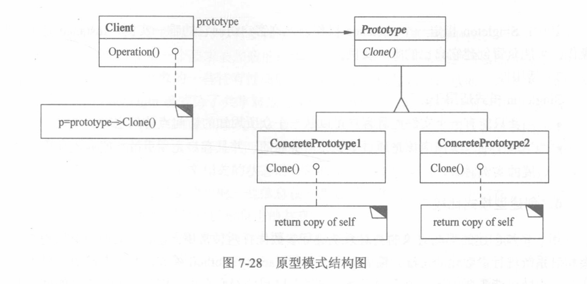
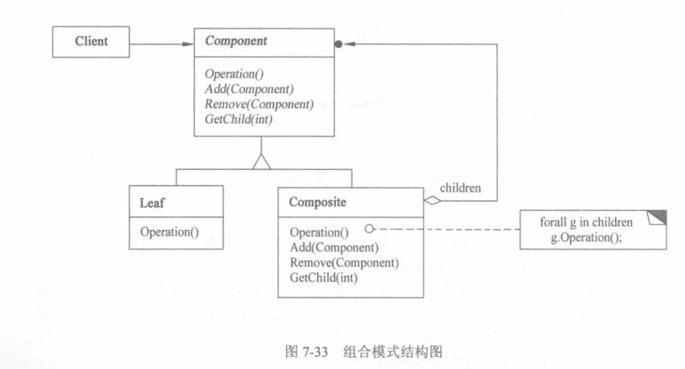
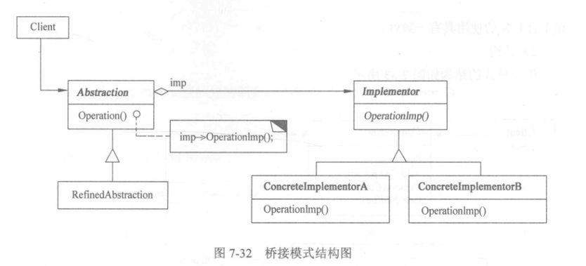
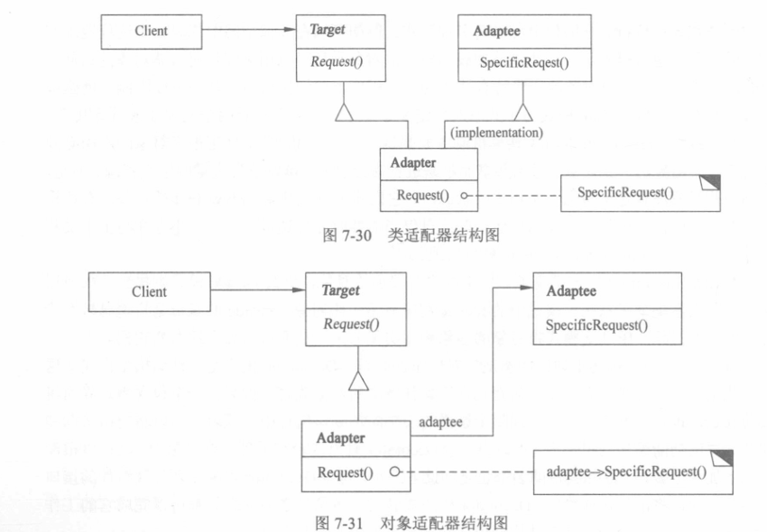

# DesignPattern

Java设计模式学习笔记

---

## 目录结构

```
src/
├── creational/              # 创建型模式（5种）
│   ├── abstractfactory/     # 抽象工厂模式
│   ├── builder/             # 生成器模式
│   ├── factorymethod/       # 工厂方法模式
│   ├── prototype/           # 原型模式
│   └── singleton/           # 单例模式
├── structural/              # 结构型模式（7种，待编码实现）
│   ├── composite/           # 组合模式
│   ├── proxy/               # 代理模式
│   ├── flyweight/           # 享元模式
│   ├── facade/              # 外观模式
│   ├── bridge/              # 桥接模式
│   ├── decorator/           # 装饰模式
│   └── adapter/             # 适配器模式
└── behavioral/              # 行为型模式（11种，已实现9种）
    ├── strategy/            # 策略模式
    ├── observer/            # 观察者模式
    ├── templatemethod/      # 模板方法模式
    ├── chainofresponsibility/ # 责任链模式
    ├── command/             # 命令模式
    ├── state/               # 状态模式
    ├── memento/             # 备忘录模式
    ├── mediator/            # 中介者模式
    ├── iterator/            # 迭代器模式
    ├── visitor/             # 访问者模式（待学习）
    └── interpreter/         # 解释器模式（待学习）
```

---

## 一、创建型模式

### 1. 抽象工厂模式（Abstract Factory）

#### 什么是抽象工厂模式？

**一句话**：提供一个接口，用于创建一系列相关的产品，而不需要指定具体类。

#### 生活中的例子：家具工厂

| 角色 | 对应类 |
|------|--------|
| 抽象工厂 | `AbstractFactory` - 定义能生产什么 |
| 现代工厂 | `ConcreteFactory1` - 生产现代家具 |
| 古典工厂 | `ConcreteFactory2` - 生产古典家具 |
| 抽象椅子 | `AbstractProductA` - 椅子接口 |
| 现代椅子 | `ProductA1` |
| 古典椅子 | `ProductA2` |
| 抽象桌子 | `AbstractProductB` - 桌子接口 |
| 现代桌子 | `ProductB1` |
| 古典桌子 | `ProductB2` |

#### UML类图



#### 图解说明

**1. 左侧 - 工厂部分**

```
┌─────────────────┐
│  AbstractFactory│  ← 抽象工厂接口
│  CreateProductA()│    定义"能生产什么"
│  CreateProductB()│
└────────┬────────┘
         │ 继承
    ┌────┴────┐
    ▼         ▼
┌──────────┐ ┌──────────┐
│Concrete   │ │Concrete   │  ← 具体工厂
│Factory1  │ │Factory2  │    实现具体生产逻辑
└──────────┘ └──────────┘
```

**2. 右侧 - 产品部分**

```
AbstractProductA（抽象产品A接口）
       ├── ProductA1（具体产品A1）
       └── ProductA2（具体产品A2）

AbstractProductB（抽象产品B接口）
       ├── ProductB1（具体产品B1）
       └── ProductB2（具体产品B2）
```

**3. 虚线箭头 - 依赖关系**

```
ConcreteFactory1 ┄┄┄→ ProductA1  （工厂1生产产品A1）
ConcreteFactory1 ┄┄┄→ ProductB1  （工厂1生产产品B1）
ConcreteFactory2 ┄┄┄→ ProductA2  （工厂2生产产品A2）
ConcreteFactory2 ┄┄┄→ ProductB2  （工厂2生产产品B2）
```

**4. Client（客户端）**

```
Client ────→ AbstractFactory      （使用工厂）
Client ────→ AbstractProductA     （使用产品A）
Client ────→ AbstractProductB     （使用产品B）
```

Client 只依赖抽象接口，不知道具体是哪个工厂或产品。

---

#### 图与代码的对应关系

| 图中元素 | 代码文件 | 说明 |
|---------|---------|------|
| AbstractFactory | `AbstractFactory.java` | 抽象工厂接口 |
| CreateProductA() | `createChair()` | 生产产品A的方法 |
| CreateProductB() | `createTable()` | 生产产品B的方法 |
| ConcreteFactory1 | `ConcreteFactory1.java` | 现代家具工厂 |
| ConcreteFactory2 | `ConcreteFactory2.java` | 古典家具工厂 |
| AbstractProductA | `AbstractProductA.java` | 椅子接口 |
| AbstractProductB | `AbstractProductB.java` | 桌子接口 |
| ProductA1 | `ProductA1.java` | 现代椅子 |
| ProductA2 | `ProductA2.java` | 古典椅子 |
| ProductB1 | `ProductB1.java` | 现代桌子 |
| ProductB2 | `ProductB2.java` | 古典桌子 |

#### 核心思想

1. **产品配套**：一个工厂只生产一种风格，不会混搭
2. **易于切换**：换风格 = 换工厂
3. **易于扩展**：新增风格 = 新增工厂类

#### 运行结果

```
=== 现代风格家具 ===
坐在现代简约椅子上，舒适简洁
在现代简约桌子上放东西，干净利落

=== 古典风格家具 ===
坐在古典雕花椅子上，优雅复古
在古典实木桌子上放东西，古色古香
```

#### 适用场景

- 系统需要多套产品系列（如：不同主题的UI组件）
- 需要确保产品配套使用
- 想要隔离具体类的依赖

#### 优劣势

| 优势 | 劣势 |
|------|------|
| ✅ 产品配套，不会混搭（华为手机配华为平板） | ❌ 新增产品类型困难（要改抽象工厂接口） |
| ✅ 易于切换风格（换个工厂就行） | ❌ 类数量增多（每个产品都要一个类） |
| ✅ 符合开闭原则（新增风格只加类） | ❌ 代码复杂度增加 |

---

### 2. 生成器模式（Builder Pattern）

#### 什么是生成器模式？

**一句话**：将复杂对象的构建过程与表示分离，同样的构建过程可以创建不同的表示。

#### 生活中的例子：造房子

| 角色 | 对应类 | 说明 |
|------|--------|------|
| 工头 | `Director` | 指挥建造流程，告诉工人先干什么再干什么 |
| 工人接口 | `Builder` | 定义建造步骤，但不知道具体怎么造 |
| 别墅施工队 | `VillaBuilder` | 实现别墅的建造 |
| 平房施工队 | `BungalowBuilder` | 实现平房的建造 |
| 房子 | `House` | 最终产品 |

#### UML类图



#### 图解说明

**1. Director（指挥者/工头）**

```
Director
├── construct()    // 指挥建造流程
└── builder        // 持有建造者引用
```

**2. Builder（抽象建造者）**

```
Builder
├── buildFoundation()   // 打地基
├── buildWall()         // 砌墙
├── buildRoof()         // 盖屋顶
└── getResult()         // 获取结果
```

**3. ConcreteBuilder（具体建造者）**

```
VillaBuilder        BungalowBuilder
├── 别墅地基         ├── 平房地基
├── 别墅墙壁         ├── 平房墙壁
├── 别墅屋顶         ├── 平房屋顶
└── 返回别墅         └── 返回平房
```

#### 核心思想

```
Director（工头）只关心流程：
    buildFoundation() → buildWall() → buildRoof()

Builder（工人）关心实现：
    具体怎么打地基、怎么砌墙、怎么盖屋顶
```

#### 代码结构

```
Builder.java            // 抽象建造者接口
├── buildFoundation()   // 步骤1：打地基
├── buildWall()         // 步骤2：砌墙
├── buildRoof()         // 步骤3：盖屋顶
└── getResult()         // 获取产品

VillaBuilder.java       // 别墅施工队（具体建造者）
BungalowBuilder.java    // 平房施工队（具体建造者）

Director.java           // 工头（指挥者）
└── construct()         // 按顺序调用建造步骤

House.java              // 产品（房子）
```

#### 运行结果

```
=== 建造别墅 ===
工头：开始指挥建造...
别墅施工队：打别墅地基（深度5米，钢筋混凝土）
别墅施工队：砌别墅墙壁（三层，落地窗）
别墅施工队：盖别墅屋顶（坡屋顶，琉璃瓦）
工头：建造完成！
结果：房子 {地基='别墅地基（深度5米，钢筋混凝土）', 墙壁='别墅墙壁（三层，落地窗）', 屋顶='别墅屋顶（坡屋顶，琉璃瓦）'}

=== 建造平房 ===
工头：开始指挥建造...
平房施工队：打平房地基（深度2米，普通混凝土）
平房施工队：砌平房墙壁（一层，普通窗户）
平房施工队：盖平房屋顶（平顶，防水层）
工头：建造完成！
结果：房子 {地基='平房地基（深度2米，普通混凝土）', 墙壁='平房墙壁（一层，普通窗户）', 屋顶='平房屋顶（平顶，防水层）'}
```

#### 适用场景

- 对象有很多属性，有些可选
- 需要按步骤创建复杂对象
- 想要同样的流程创建不同类型的对象

#### 优劣势

| 优势 | 劣势 |
|------|------|
| ✅ 分离构建过程，同样的流程造不同产品 | ❌ 每个产品都要写一个Builder类 |
| ✅ 可以精细控制构建步骤 | ❌ 产品之间差异太大时不适用 |
| ✅ 链式调用更优雅（可选） | ❌ 增加了Director、Builder等类 |
| ✅ 不可变对象更容易实现 | ❌ 对于简单对象，反而增加复杂度 |

---

### 3. 工厂方法模式（Factory Method）

#### 什么是工厂方法模式？

**一句话**：让子类决定创建什么对象，父类只定义使用对象的流程。

#### 生活中的例子：数据库连接

| 角色 | 对应类 | 说明 |
|------|--------|------|
| 数据库工厂 | `DatabaseFactory` | 抽象工厂，定义连接流程 |
| MySQL工厂 | `MySQLFactory` | 创建MySQL连接 |
| Oracle工厂 | `OracleFactory` | 创建Oracle连接 |
| 数据库连接 | `DatabaseConnection` | 抽象产品，定义连接功能 |
| MySQL连接 | `MySQLConnection` | 具体产品1 |
| Oracle连接 | `OracleConnection` | 具体产品2 |

#### UML类图


#### 图解说明

**1. Creator（抽象工厂）**

```
DatabaseFactory（抽象工厂）
├── createConnection()    // 工厂方法：让子类实现
└── executeQuery()        // 业务方法：使用连接
```

**2. ConcreteCreator（具体工厂）**

```
MySQLFactory              OracleFactory
├── createConnection()    ├── createConnection()
└── return MySQL          └── return Oracle
```

**3. Product（抽象产品）**

```
DatabaseConnection（数据库连接接口）
├── connect()    // 连接
├── query()      // 查询
└── close()      // 关闭
```

**4. ConcreteProduct（具体产品）**

```
MySQLConnection           OracleConnection
├── 连接MySQL             ├── 连接Oracle
├── 执行MySQL查询         ├── 执行Oracle查询
└── 关闭MySQL连接         └── 关闭Oracle连接
```

#### 核心思想

```
父类（DatabaseFactory）：
    我要用连接，但不知道用哪个
    子类告诉我（createConnection）

子类（MySQLFactory/OracleFactory）：
    我知道创建哪个连接
    return new MySQLConnection()
```

#### 代码结构

```
DatabaseConnection.java       // 抽象产品：数据库连接接口
├── connect()
├── query()
└── close()

MySQLConnection.java          // 具体产品1：MySQL连接
OracleConnection.java         // 具体产品2：Oracle连接

DatabaseFactory.java          // 抽象工厂：定义流程
├── createConnection()        // 工厂方法（抽象）
└── executeQuery()            // 业务方法

MySQLFactory.java             // 具体工厂1：创建MySQL连接
OracleFactory.java            // 具体工厂2：创建Oracle连接
```

#### 运行结果

```
=== 使用 MySQL ===
MySQL工厂：创建MySQL连接
=== 开始执行查询 ===
连接 MySQL 数据库：jdbc:mysql://localhost:3306/mydb
MySQL 执行查询：SELECT * FROM users
关闭 MySQL 连接
=== 查询结束 ===

=== 使用 Oracle ===
Oracle工厂：创建Oracle连接
=== 开始执行查询 ===
连接 Oracle 数据库：jdbc:oracle:thin:@localhost:1521:orcl
Oracle 执行查询：SELECT * FROM orders
关闭 Oracle 连接
=== 查询结束 ===
```

#### 适用场景

- 不知道具体用哪个类（根据配置决定）
- 未来会加新品类（加新类不动旧代码）
- 想让子类决定创建什么对象

#### 优劣势

| 优势 | 劣势 |
|------|------|
| ✅ 符合开闭原则（加新品只加类） | ❌ 每个产品都要一个工厂类 |
| ✅ 解耦（父类不依赖具体类） | ❌ 类数量增多 |
| ✅ 易于扩展（加新工厂就行） | ❌ 对于简单场景有点过度设计 |

#### 与抽象工厂的区别

| 工厂方法 | 抽象工厂 |
|---------|---------|
| 一个工厂只生产**一种**产品 | 一个工厂生产**一系列**产品 |
| `createConnection()` | `createChair()` + `createTable()` |
| 简单，但产品多了工厂也多 | 产品配套，但结构复杂 |

---

### 4. 原型模式（Prototype Pattern）

#### 什么是原型模式？

**一句话**：用克隆代替new，复制已有对象来创建新对象。

#### 生活中的例子：简历投递

| 角色 | 对应 | 说明 |
|------|------|------|
| 简历模板 | `Resume` | 包含基本信息的模板 |
| 克隆方法 | `clone()` | 复制简历 |
| 投递简历 | 克隆后修改目标公司 | 不用重新写 |

#### UML类图



#### 图解说明

**1. Prototype（原型接口）**

```
Prototype
└── Clone()  // 克隆方法，返回自己的副本
```

**2. ConcretePrototype（具体原型）**

```
Resume（简历）
├── name        // 姓名
├── education   // 学历
├── skills      // 技能
├── targetCompany  // 目标公司
└── Clone()     // 克隆自己，返回新简历
```

**3. Client（客户端）**

```
Client
├── 创建模板简历
├── 克隆简历1 → 修改目标公司
├── 克隆简历2 → 修改目标公司
└── 克隆简历3 → 修改目标公司
```

#### 核心思想

```
传统方式：new一个新对象，手动设置属性
    User user = new User();
    user.setName("张三");
    user.setAge(25);

原型模式：克隆已有对象
    User user = template.clone();
    user.setTargetCompany("阿里巴巴");
```

#### 代码结构

```
Resume.java     // 具体原型：简历
├── name, education, skills  // 基本信息（不变）
├── targetCompany            // 目标公司（可变）
└── clone()                  // 克隆方法

Client.java     // 测试类
├── 创建模板
├── 克隆多份简历
└── 修改目标公司
```

#### 运行结果

```
=== 创建简历模板 ===
模板内容：
姓名：张三
学历：本科
技能：Java, Python, 设计模式
目标公司：（待定）

=== 克隆简历投递不同公司 ===
--- 简历1 ---
姓名：张三
学历：本科
技能：Java, Python, 设计模式
目标公司：阿里巴巴

--- 简历2 ---
姓名：张三
学历：本科
技能：Java, Python, 设计模式
目标公司：腾讯

--- 简历3 ---
姓名：张三
学历：本科
技能：Java, Python, 设计模式
目标公司：字节跳动
```

#### 适用场景

- 对象创建成本高（比如要查数据库）
- 需要大量相似对象
- 想要保持对象状态不变

#### 优劣势

| 优势 | 劣势 |
|------|------|
| ✅ 简化对象创建（不用new + 设置属性） | ❌ 需要实现Cloneable接口 |
| ✅ 性能更好（克隆比new快） | ❌ 浅拷贝可能有问题（引用类型） |
| ✅ 保持对象状态 | ❌ 代码略复杂 |

#### 深拷贝 vs 浅拷贝

| 类型 | 说明 | 风险 |
|------|------|------|
| 浅拷贝 | 只复制基本类型，引用类型复制地址 | 修改一个会影响另一个 |
| 深拷贝 | 完全独立的副本 | 安全，但更耗性能 |

---

### 5. 单例模式（Singleton Pattern）

#### 什么是单例模式？

**一句话**：保证一个类只有一个实例，并提供全局访问点。

#### 生活中的例子：校长

一个学校只有一个校长，不管谁去找校长，找到的都是同一个人。

| 角色 | 对应 | 说明 |
|------|------|------|
| 学校 | Singleton类 | 整个系统只有一个 |
| 校长 | uniqueInstance | 唯一的实例 |
| 找校长 | getInstance() | 获取唯一实例的方法 |

#### UML类图



#### 图解说明

**1. Singleton（单例类）**

```
Singleton
├── static Instance()       // 静态方法：获取唯一实例
├── SingletonOperation()    // 业务方法
├── GetSingletonData()      // 获取数据
├── static uniqueInstance   // 静态变量：保存唯一实例
└── singletonData           // 单例的数据
```

**2. 关键点**

```
构造函数私有化 → 不能从外部 new
静态变量 → 保存唯一的实例
静态方法 → 提供获取实例的入口
```

#### 核心思想

```
不管调用多少次 getInstance()，返回的都是同一个对象

Singleton s1 = Singleton.getInstance();
Singleton s2 = Singleton.getInstance();
s1 == s2  // true，同一个实例
```

#### 两种实现方式

| 方式 | 特点 | 适用场景 |
|------|------|---------|
| 懒汉式 | 用到时才创建（懒加载） | 实例创建开销大 |
| 饿汉式 | 类加载时就创建 | 实例创建开销小，需要快速访问 |

#### 代码结构

**懒汉式（SingletonLazy.java）**

```
private static SingletonLazy instance;  // 初始为null

public static SingletonLazy getInstance() {
    if (instance == null) {  // 第一次调用时才创建
        instance = new SingletonLazy();
    }
    return instance;
}
```

**饿汉式（SingletonHungry.java）**

```
private static SingletonHungry instance = new SingletonHungry();  // 类加载时就创建

public static SingletonHungry getInstance() {
    return instance;  // 直接返回，不用判断
}
```

#### 运行结果

```
=== 测试懒汉式 ===
懒汉式：实例被创建
s1 == s2 ? true
懒汉式单例执行业务逻辑

=== 测试饿汉式 ===
饿汉式：实例被创建
s3 == s4 ? true
饿汉式单例执行业务逻辑
```

#### 适用场景

- 数据库连接池（全局只有一个）
- 日志记录器（全局共享）
- 配置管理器（统一配置）
- 线程池（统一管理）

#### 优劣势

| 优势 | 劣势 |
|------|------|
| ✅ 节省内存（只有一个实例） | ❌ 懒汉式线程不安全（需要加锁） |
| ✅ 全局访问点 | ❌ 测试困难（单例难以mock） |
| ✅ 控制实例数量 | ❌ 可能造成全局状态 |

#### 懒汉式 vs 饿汉式

| 对比项 | 懒汉式 | 饿汉式 |
|--------|--------|--------|
| 创建时机 | 用到时才创建 | 类加载时就创建 |
| 线程安全 | 不安全（需加锁） | 安全 |
| 内存占用 | 延迟加载 | 提前占用 |
| 性能 | 第一次慢 | 第一次快 |

#### 懒汉式线程安全问题

**问题演示（SingletonUnsafe.java）**

```java
public static SingletonUnsafe getInstance() {
    if (instance == null) {        // 线程A判断null，准备创建
        instance = new SingletonUnsafe();  // 线程B也判断null，也创建
    }
    return instance;
}
```

**多线程测试结果**

```
启动10个线程，同时获取单例...

线程 Thread-0 获取到实例，hashCode=123456
线程 Thread-1 获取到实例，hashCode=789012  ← 不同的实例！
线程 Thread-2 获取到实例，hashCode=345678  ← 又一个不同的实例！

=== 结果分析 ===
总共创建了 3 个不同的实例
❌ 线程不安全！创建了多个实例！
```

**原因分析**

```
线程A：判断 instance == null → true
线程B：判断 instance == null → true（还没等线程A创建完）
线程A：创建实例
线程B：创建实例（覆盖了线程A的）
结果：两个实例！
```

#### 解决方案1：synchronized 方法

```java
public static synchronized SingletonSafe getInstance() {
    if (instance == null) {
        instance = new SingletonSafe();
    }
    return instance;
}
```

| 优点 | 缺点 |
|------|------|
| 简单 | 每次调用都加锁，效率低 |

#### 解决方案2：双重检查锁（推荐）

```java
public static SingletonDoubleCheck getInstance() {
    if (instance == null) {          // 第一次检查（不加锁）
        synchronized (SingletonDoubleCheck.class) {
            if (instance == null) {  // 第二次检查（加锁后确认）
                instance = new SingletonDoubleCheck();
            }
        }
    }
    return instance;
}
```

| 优点 | 缺点 |
|------|------|
| 只在第一次加锁，效率高 | 代码略复杂，需要volatile |

#### 三种实现方式对比

| 方式 | 线程安全 | 性能 | 复杂度 |
|------|---------|------|--------|
| 懒汉式（无锁） | ❌ 不安全 | 高 | 简单 |
| 懒汉式（synchronized） | ✅ 安全 | 低 | 简单 |
| 双重检查锁 | ✅ 安全 | 高 | 复杂 |
| 饿汉式 | ✅ 安全 | 高 | 简单 |

---

### 6. 创建型模式比较

#### 两种创建对象的方式

| 方式 | 对应模式 | 原理 |
|------|---------|------|
| **生成子类** | 工厂方法 | 通过继承，让子类决定创建什么 |
| **对象复合** | 抽象工厂、生成器、原型 | 通过组合，用一个"工厂对象"来创建 |

#### 逐个对比

| 模式 | 怎么创建对象 | 一句话特点 |
|------|-------------|-----------|
| **工厂方法** | 通过子类创建 | 简单，但产品多了工厂类也多 |
| **抽象工厂** | 用工厂对象创建**一系列**产品 | 产品配套，不会混搭 |
| **生成器** | 用工厂对象**逐步构建**复杂产品 | 分离流程和实现 |
| **原型** | 用工厂对象**克隆**已有产品 | 不用new，复制就行 |

#### 核心区别

```
工厂方法：用继承（子类决定）
抽象工厂/生成器/原型：用组合（工厂对象决定）
```

#### 选择指南

| 场景 | 推荐模式 |
|------|---------|
| 只有一种产品，简单创建 | 工厂方法 |
| 多种配套产品（如：主题UI） | 抽象工厂 |
| 复杂对象需要分步构建 | 生成器 |
| 对象创建成本高，需要复制 | 原型 |
| 全局只能有一个实例 | 单例 |

---

## 二、结构型模式

### 什么是结构型模式？

**一句话**：研究"怎么把类和对象组装成更大的结构"

### 两种组合方式

| 方式 | 原理 | 特点 |
|------|------|------|
| **类结构型** | 用继承组合 | 静态，编译时确定 |
| **对象结构型** | 用组合关系 | 动态，运行时可变 |

### 7种结构型模式

| 模式 | 一句话 | 生活例子 |
|------|--------|---------|
| Composite | 树形结构统一处理 | 公司组织架构 |
| Proxy | 找替身代替你 | 明星代言 |
| Flyweight | 共享数据省内存 | 文字重复使用 |
| Facade | 简单入口隐藏细节 | 一键启动 |
| Bridge | 功能和实现分开 | 遥控器+电视 |
| Decorator | 动态加装备 | 手机+手机壳 |
| Adapter | 让不兼容的兼容 | 电源转换器 |

---

### 1. 组合模式（Composite Pattern）

#### 什么是组合模式？

**一句话**：把树形结构的东西统一处理，让单个对象和组合对象使用相同的接口。

#### 生活中的例子：公司组织架构

```
总经理
├── 技术部
│   ├── 开发组
│   └── 测试组
└── 市场部
    ├── 销售组
    └── 推广组
```

不管是"部门"还是"小组"，都可以用同样的方式管理（发通知、开会、统计人数）。

#### UML类图



#### 角色说明

| 角色 | 对应类 | 说明 |
|------|--------|------|
| Component | `OrganizationUnit` | 抽象组件，定义统一接口 |
| Leaf | `Employee` | 叶子节点，员工（没有下级） |
| Composite | `Department` | 容器节点，部门（有下级） |

#### 图解说明

**1. Component（抽象组件）- 组织单元**

```
OrganizationUnit（接口）
├── getName()        // 获取名称
├── display(depth)   // 显示信息
└── getStaffCount()  // 获取人数
```

**2. Leaf（叶子节点）- 员工**

```
Employee implements OrganizationUnit
├── name             // 员工名称
├── display()        // 打印员工
└── getStaffCount()  // 返回1
```

**3. Composite（容器节点）- 部门**

```
Department implements OrganizationUnit
├── name             // 部门名称
├── children         // 子节点列表（员工或其他部门）
├── add()            // 添加子节点
├── remove()         // 删除子节点
├── display()        // 打印部门，然后递归打印子节点
└── getStaffCount()  // 累加子节点人数
```

#### 核心思想

```
把"单个对象"（员工）和"组合对象"（部门）统一处理：

调用 ceo.display(0)：
    → 打印"总经理"
    → 遍历子节点，调用 display()
        → 技术部.display()
            → 打印"技术部"
            → 遍历子节点...
                → 开发组.display()
                    → 打印"开发组"
                    → 遍历子节点...
                        → 张三.display()
                        → 李四.display()
```

#### 代码结构

```
OrganizationUnit.java    # 抽象组件：组织单元接口
├── getName()
├── display(depth)
└── getStaffCount()

Employee.java            # 叶子节点：员工
├── name                 # 员工名称
├── display()            # 打印员工
└── getStaffCount()      # 返回1

Department.java          # 容器节点：部门
├── name                 # 部门名称
├── children             # 子节点列表
├── add()                # 添加子节点
├── remove()             # 删除子节点
├── display()            # 递归显示
└── getStaffCount()      # 递归统计人数
```

#### 运行结果

```
=== 组织架构 ===
+ 总经理
  + 技术部
    + 开发组
      - 张三
      - 李四
    + 测试组
      - 王五
  + 市场部
    - 赵六
    - 孙七

=== 人数统计 ===
开发组人数：2
技术部人数：3
公司总人数：5
```

#### 适用场景

- 树形结构（部门、文件夹、菜单）
- 需要统一处理叶子和组合对象
- 数据结构可以表示为树

#### 优劣势

| 优势 | 劣势 |
|------|------|
| ✅ 统一处理叶子和容器 | ❌ 限制类型困难 |
| ✅ 易于扩展新组件 | ❌ 树形结构可能太复杂 |
| ✅ 符合开闭原则 | ❌ 可能过于通用 |

---

### 2. 桥接模式（Bridge Pattern）

#### 什么是桥接模式？

**一句话**：把"功能"和"实现"分开，通过桥连接，可以自由组合。

#### 生活中的例子：支付系统

| 角色 | 对应类 | 说明 |
|------|--------|------|
| 支付方式（抽象） | `PayMethod` | 扫码支付、刷脸支付 |
| 支付渠道（实现） | `PayChannel` | 微信、支付宝 |
| 桥 | `channel` 引用 | 连接支付方式和支付渠道 |

#### UML类图



#### 图解说明

**1. Abstraction（抽象部分）- 支付方式**

```
PayMethod（抽象类）
├── channel: PayChannel  ← 桥：持有支付渠道的引用
└── pay(amount)          ← 抽象方法：定义"做什么"
```

**2. RefinedAbstraction（扩展抽象）- 具体支付方式**

```
PayMethod
    ├── ScanPay（扫码支付）
    └── FacePay（刷脸支付）
```

**3. Implementor（实现接口）- 支付渠道**

```
PayChannel（接口）
└── pay(amount)  ← 实现方法：定义"怎么做"
      │
      ├── WechatPay（微信）
      └── Alipay（支付宝）
```

#### 核心思想

```
支付方式和支付渠道独立变化：

支付方式：扫码、刷脸、指纹...
支付渠道：微信、支付宝、银联...

组合：
├── 扫码 + 微信
├── 扫码 + 支付宝
├── 刷脸 + 微信
└── 刷脸 + 支付宝
```

#### 代码结构

```
PayChannel.java      # 实现接口：支付渠道
├── WechatPay.java   # 具体实现：微信
└── Alipay.java      # 具体实现：支付宝

PayMethod.java       # 抽象类：支付方式
├── channel          # 桥：持有PayChannel引用
└── pay(amount)      # 抽象方法

ScanPay.java         # 扩展抽象：扫码支付
FacePay.java         # 扩展抽象：刷脸支付
```

#### 运行结果

```
=== 扫码支付 + 微信 ===
【扫码支付】
  -> 微信支付：100.0元

=== 扫码支付 + 支付宝 ===
【扫码支付】
  -> 支付宝：200.0元

=== 刷脸支付 + 微信 ===
【刷脸支付】
  -> 微信支付：150.0元

=== 刷脸支付 + 支付宝 ===
【刷脸支付】
  -> 支付宝：300.0元
```

#### 适用场景

- 两个维度独立变化（支付方式 × 支付渠道）
- 需要运行时切换实现
- 避免多层继承导致类爆炸

#### 优劣势

| 优势 | 劣势 |
|------|------|
| ✅ 分离抽象和实现 | ❌ 增加了理解难度 |
| ✅ 独立扩展 | ❌ 需要正确的设计 |
| ✅ 运行时切换 | ❌ 类数量增多 |

#### 与继承的区别

| 继承 | 桥接 |
|------|------|
| 编译时确定 | 运行时可变 |
| 类爆炸（N×M个类） | 只需 N+M 个类 |
| 静态绑定 | 动态组合 |

#### 核心好处：避免类爆炸

**不用桥接（3×3=9个类）：**

```
ScanWechatPay     扫码+微信
ScanAlipay        扫码+支付宝
ScanUnionPay      扫码+银联
FaceWechatPay     刷脸+微信
FaceAlipay        刷脸+支付宝
FaceUnionPay      刷脸+银联
FingerWechatPay   指纹+微信
FingerAlipay      指纹+支付宝
FingerUnionPay    指纹+银联
```

**用桥接（3+3=6个类）：**

```
支付方式：ScanPay、FacePay、FingerPay
支付渠道：WechatPay、Alipay、UnionPay

组合：new ScanPay(new WechatPay())
```

| 方式 | 3×3 | 4×4 | 5×5 |
|------|-----|-----|-----|
| 继承 | 9个类 | 16个类 | 25个类 |
| 桥接 | 6个类 | 8个类 | 10个类 |

#### 三个判断标准（什么时候用）

**标准1：有两个维度独立变化**

```
支付系统：
├── 维度1：支付方式（扫码、刷脸、指纹）
└── 维度2：支付渠道（微信、支付宝、银联）
```

**标准2：不想用继承导致类爆炸**

```
如果写成这样，就是警告信号：
class ScanWechatPay { }
class ScanAlipay { }
class FaceWechatPay { }
class FaceAlipay { }
... 越来越多
```

**标准3：需要运行时切换实现**

```java
PayChannel channel = config.getPayChannel();  // 运行时决定
PayMethod pay = new ScanPay(channel);
```

#### 实际应用场景

| 场景 | 维度1 | 维度2 |
|------|-------|-------|
| 支付系统 | 支付方式 | 支付渠道 |
| 消息发送 | 消息类型 | 发送方式 |
| 图形绘制 | 图形形状 | 颜色 |
| 数据库访问 | 数据类型 | 数据库类型 |
| 日志系统 | 日志级别 | 输出目标 |

---

### 3. 代理模式（Proxy Pattern）

#### 什么是代理模式？

**一句话**：找个"替身"代替你做事，控制对真实对象的访问。

#### 生活中的例子：明星代言

| 角色 | 对应 | 说明 |
|------|------|------|
| 明星本人 | 真实对象 | 真正干活的人 |
| 代言人 | 代理 | 代替明星出席活动 |

#### 代理的类型

| 类型 | 说明 | 例子 |
|------|------|------|
| 远程代理 | 代替远程对象 | RPC调用 |
| 虚拟代理 | 延迟创建大对象 | 图片懒加载 |
| 保护代理 | 控制访问权限 | 权限校验 |

#### 适用场景

- 远程对象访问
- 延迟加载大对象
- 需要控制访问权限

#### 优劣势

| 优势 | 劣势 |
|------|------|
| ✅ 保护真实对象 | ❌ 增加了代理类 |
| ✅ 控制访问权限 | ❌ 可能降低性能 |
| ✅ 延迟加载 | ❌ 代码复杂度增加 |

---

### 4. 享元模式（Flyweight Pattern）

#### 什么是享元模式？

**一句话**：多个对象共享同一份数据，节省内存。

#### 生活中的例子：文字编辑器

```
写"你好你好"

不用创建4个"你"对象
只需要1个"你"对象，重复使用
```

#### 适用场景

- 大量相似对象
- 对象的大部分状态可以外部化
- 需要节省内存

#### 优劣势

| 优势 | 劣势 |
|------|------|
| ✅ 大幅节省内存 | ❌ 增加了复杂度 |
| ✅ 提高性能 | ❌ 需要分离内部/外部状态 |

---

### 5. 外观模式（Facade Pattern）

#### 什么是外观模式？

**一句话**：提供一个简单入口，隐藏复杂细节。

#### 生活中的例子：一键启动

```
你按一个按钮 → 电脑开机
背后：启动系统、加载驱动、初始化程序...
你不需要知道这些，只管按按钮
```

#### 适用场景

- 简化复杂系统的使用
- 提供统一入口
- 分层系统中定义层间入口

#### 优劣势

| 优势 | 劣势 |
|------|------|
| ✅ 简化使用 | ❌ 可能成为上帝类 |
| ✅ 解耦客户端和子系统 | ❌ 不限制直接访问 |

---

### 6. 装饰模式（Decorator Pattern）

#### 什么是装饰模式？

**一句话**：动态给对象"加装备"，不改变对象本身，可以层层嵌套。

#### 生活中的例子：买手机

```
基础款：手机（能打电话）
+ 装饰1：手机壳（保护）
+ 装饰2：钢化膜（防摔）
+ 装饰3：挂绳（便携）

每加一个装饰，功能增强，但还是手机
```

#### UML类图


#### 角色说明

| 角色 | 对应类 | 说明 |
|------|--------|------|
| Component | `Phone` | 手机接口 |
| ConcreteComponent | `NormalPhone` | 普通手机（没有装饰） |
| Decorator | `PhoneDecorator` | 装饰器基类 |
| ConcreteDecorator | `PhoneCase`、`ScreenProtector`、`PhoneStrap` | 具体装饰器 |

#### 图解说明

**1. Component（抽象组件）- 手机接口**

```
Phone（接口）
├── call()           // 打电话
├── send()           // 发短信
└── getDescription() // 获取描述
```

**2. ConcreteComponent（具体组件）- 普通手机**

```
NormalPhone implements Phone
└── call()  // 实现：打电话
```

**3. Decorator（装饰器基类）**

```
PhoneDecorator implements Phone
├── phone: Phone     ← 持有被装饰对象的引用
├── call()           // 调用 phone.call()
└── getDescription() // 调用 phone.getDescription()
```

**4. ConcreteDecorator（具体装饰器）- 手机壳、钢化膜**

```
PhoneDecorator
    ├── PhoneCase        手机壳（新增：保护）
    ├── ScreenProtector  钢化膜（新增：防摔）
    └── PhoneStrap       挂绳（新增：便携）
```

#### 核心思想：套娃

```
手机壳(钢化膜(手机))
      │      │
      │      └── 钢化膜包裹手机
      └── 手机壳包裹钢化膜

调用 call()：
    手机壳.call()
        → 钢化膜.call()
            → 手机.call()  // 最终执行
        → 手机壳：保护手机
    钢化膜：屏幕防摔
```

#### 代码结构

```
Phone.java              # 抽象组件：手机接口
├── call()
├── send()
└── getDescription()

NormalPhone.java        # 具体组件：普通手机
├── call()              // 打电话
└── getDescription()    // "普通手机"

PhoneDecorator.java     # 装饰器基类
├── phone               # 持有被装饰对象
├── call()              // 调用 phone.call()
└── getDescription()    // 调用 phone.getDescription()

PhoneCase.java          # 具体装饰器：手机壳
├── call()              // super.call() + 保护功能
└── getDescription()    // "... + 手机壳"

ScreenProtector.java    # 具体装饰器：钢化膜
├── call()              // super.call() + 防摔功能
└── getDescription()    // "... + 钢化膜"

PhoneStrap.java         # 具体装饰器：挂绳
├── call()              // super.call() + 便携功能
└── getDescription()    // "... + 挂绳"
```

#### 运行结果

```
=== 场景1：裸机（没有装饰）===
配置：普通手机
普通手机：打电话

=== 场景2：加手机壳 ===
配置：普通手机 + 手机壳
普通手机：打电话
  -> 手机壳：保护手机不被摔坏

=== 场景3：手机壳 + 钢化膜（嵌套装饰）===
配置：普通手机 + 钢化膜 + 手机壳
普通手机：打电话
  -> 钢化膜：屏幕防摔
  -> 手机壳：保护手机不被摔坏

=== 场景4：手机壳 + 钢化膜 + 挂绳（三层嵌套）===
配置：普通手机 + 挂绳 + 钢化膜 + 手机壳
普通手机：打电话
  -> 挂绳：方便携带
  -> 钢化膜：屏幕防摔
  -> 手机壳：保护手机不被摔坏
```

#### 适用场景

- 动态添加功能
- 不改变对象的情况下扩展功能
- 功能可以自由组合
- 需要层层嵌套装饰

#### 优劣势

| 优势 | 劣势 |
|------|------|
| ✅ 动态扩展功能 | ❌ 会产生很多小类 |
| ✅ 符合开闭原则 | ❌ 比继承更灵活但也更复杂 |
| ✅ 功能自由组合 | ❌ 装饰顺序可能影响结果 |

#### 装饰器 vs 继承

| 继承 | 装饰器 |
|------|--------|
| 编译时确定 | 运行时动态添加 |
| 类数量爆炸 | 可以自由组合 |
| 静态 | 动态 |

---

### 7. 适配器模式（Adapter Pattern）

#### 什么是适配器模式？

**一句话**：让不兼容的接口能一起工作。

#### 生活中的例子：电源转换器

```
中国插头（220V）→ 适配器 → 美国插座（110V）
```

#### UML类图




#### 角色说明

| 角色 | 对应类 | 说明 |
|------|--------|------|
| Target（目标接口） | `Electronic` | 统一的电器接口 |
| Adaptee（被适配者） | `USLaptop` | 美国电器（110V，接口不兼容） |
| Adapter（适配器） | `ClassAdapter` / `ObjectAdapter` | 电源转换器（将110V适配成220V） |
| Client（客户端） | `Client` | 用户，只认识 Electronic 接口 |

#### 核心思想

```
Client 只认识 Electronic 接口
但实际有不同实现：
    ├── ChinaLaptop：220V（兼容）
    └── USLaptop：110V（不兼容）

Adapter 负责转换：
    usePower() → 内部调用 USLaptop.usePower()
```

#### 两种实现方式对比

| 对比项 | 类适配器 | 对象适配器 |
|--------|---------|-----------|
| 实现方式 | 继承 | 组合 |
| 关系 | Adapter **是** Adaptee | Adapter **有** Adaptee |
| 灵活性 | 低（编译时确定） | 高（运行时可换） |
| Java限制 | 只能继承一个类 | 可以持有多个对象 |
| 适用场景 | 适配单一具体类 | 适配多种实现 |

#### 类适配器代码（用继承）

```java
public class ClassAdapter extends USLaptop implements Electronic {
    @Override
    public void usePower() {
        System.out.println("类适配器：将220V转换为110V");
        super.usePower();  // 调用父类（美国电器）的方法
    }
}
```

#### 对象适配器代码（用组合）

```java
public class ObjectAdapter implements Electronic {
    private Electronic adaptee;  // 持有被适配者引用（接口类型，更灵活）
    
    public ObjectAdapter(Electronic adaptee) {
        this.adaptee = adaptee;
    }
    
    @Override
    public void usePower() {
        System.out.println("对象适配器：将220V转换为110V");
        adaptee.usePower();  // 调用引用对象的方法
    }
}
```

#### 运行结果

```
=== 场景1：中国电器直接使用（不需要适配）===
中国笔记本：使用220V电源，正常工作

=== 场景2：美国电器直接使用（接口不兼容）===
美国笔记本：使用110V电源，正常工作

=== 场景3：用类适配器适配美国电器 ===
类适配器：将220V转换为110V
美国笔记本：使用110V电源，正常工作

=== 场景4：用对象适配器适配美国电器 ===
对象适配器：将220V转换为110V
美国笔记本：使用110V电源，正常工作

=== 场景5：对象适配器可以适配多种电器 ===
对象适配器：将220V转换为110V
美国笔记本：使用110V电源，正常工作
对象适配器：将220V转换为110V
中国笔记本：使用220V电源，正常工作
```

#### 适用场景

- 复用现有类，但接口不兼容
- 统一多个类的接口
- 封装第三方库

#### 优劣势

| 优势 | 劣势 |
|------|------|
| ✅ 复用现有代码 | ❌ 增加了类 |
| ✅ 解耦目标类和适配者 | ❌ 有时需要修改目标接口 |
| ✅ 符合开闭原则 | ❌ 增加复杂度 |

---

## 结构型模式选择指南

| 场景 | 推荐模式 |
|------|---------|
| 树形结构统一处理 | 组合模式 |
| 控制对象访问 | 代理模式 |
| 大量相似对象省内存 | 享元模式 |
| 简化复杂系统 | 外观模式 |
| 抽象和实现分离 | 桥接模式 |
| 动态添加功能 | 装饰模式 |
| 接口不兼容 | 适配器模式 |

---

## 三、行为型模式

### 什么是行为型模式？

**一句话**：研究"对象之间怎么协作、怎么把变化的行为抽出来"

不是怎么创建对象（创建型），也不是怎么组装对象（结构型），而是**对象之间怎么分工、怎么通信**。

### 11种行为型模式

| 模式 | 一句话 | 生活例子 |
|------|--------|---------|
| Strategy | 同一件事换着法儿做 | 购物车换折扣 |
| Observer | 一件事发生了，关心的人都知道 | 到货通知 |
| Template Method | 流程定死，步骤留空 | 奶茶店做饮品 |
| Chain of Responsibility | 击鼓传花，谁能接谁接 | 请假逐级审批 |
| Command | 请求变对象，能存能撤能排队 | 餐厅点餐单 |
| State | 状态一变，行为跟着变 | 外卖订单流转 |
| Memento | 快照一拍，随时回到过去 | 游戏存档 |
| Mediator | 都别互聊，进群找群主 | 机场塔台/聊天群 |
| Iterator | 游标一拿，挨个看过去 | 按名单点名 |
| Visitor | 不动类，加新操作 | 报表导出（待学习） |
| Interpreter | 规则写成语法树 | 四则运算（待学习） |

---

### 1. 策略模式（Strategy Pattern）

#### 什么是策略模式？

**一句话**：定义一系列算法，把它们一个个封装起来，并且使它们可以互相替换。

把"怎么做"这件事抽成接口，主体只管调用，不管具体怎么做。**同一件事，换一种做法，主体代码一行不改。**

#### 生活中的例子：到机场

同样是"从家到机场"这件事：

| 策略 | 做法 | 特点 |
|------|------|------|
| 🚗 打车 | 直接叫车 | 贵但省事 |
| 🚇 地铁 | 换乘两次 | 便宜但挤 |
| 🚌 机场大巴 | 到点发车 | 便宜但慢 |
| 🚁 直升机 | 有钱任性 | 贵但最快 |

"出行"这个需求不变，**换的是实现方式**。选哪个是运行时决定的（看时间、看预算），而不是出门前写死的。

#### 角色说明

| 角色 | 对应类 | 职责 |
|------|--------|------|
| Context（上下文） | `ShoppingCart` | 持有商品，调用策略算价格 |
| Strategy（抽象策略） | `DiscountStrategy` | 定义"计算折后价"的接口 |
| ConcreteStrategy（具体策略） | `NoDiscount` / `PercentageDiscount` / `FixedDiscount` / `VIPDiscount` | 各种打折方式 |
| Client（客户端） | `Client` | 决定用哪个策略 |

#### UML类图

```
┌──────────────────────┐         ┌─────────────────────────┐
│     ShoppingCart     │         │ «interface»             │
│──────────────────────│ 持有    │    DiscountStrategy     │
│ - productName        │────────▶│─────────────────────────│
│ - originalPrice      │         │ + calculate(originalPrice)│
│ - discountStrategy   │         └───────────┬─────────────┘
│──────────────────────│                     │ 实现（实现同一个接口）
│ + setDiscountStrategy│     ┌───────────────┼────────────────┬──────────┐
│ + checkout()         │     ▼               ▼                ▼          ▼
└──────────────────────┘ ┌──────────┐ ┌──────────────┐ ┌──────────┐ ┌──────────┐
                         │NoDiscount│ │Percentage    │ │ Fixed    │ │   VIP    │
                         │          │ │Discount      │ │ Discount │ │ Discount │
                         └──────────┘ └──────────────┘ └──────────┘ └──────────┘
```

**关键**：`ShoppingCart` 只依赖抽象的 `DiscountStrategy`，不依赖任何一个具体折扣类。

#### 核心思想

**先看不用策略模式的写法（反面教材）**：

```java
public void checkout(int discountType) {   // 1=打折 2=满减 3=VIP ...
    if (discountType == 1) {
        finalPrice = originalPrice * 0.8;
    } else if (discountType == 2) {
        // ...
    }
    // 新增一种折扣？改这个方法，全量回归测试，违反开闭原则！
}
```

问题：`checkout()` 又要管流程又要管所有算法，越加越臃肿；新增折扣 = 修改已有代码；打折算法和购物车耦合，没法复用。

**用了策略模式之后**：

```java
// 新增一种折扣？新增一个类，已有代码一行不改
cart.setDiscountStrategy(new SecondHalfDiscount());  // 直接换上，购物车无感知
```

变化点被封装在独立的类里，主体只面向接口编程——**消灭 if-else，符合开闭原则**。

#### 代码结构

```java
// 策略接口：所有折扣的"能力契约"
public interface DiscountStrategy {
    double calculate(double originalPrice);
}

// 上下文：持有策略而不是写死策略
public class ShoppingCart {
    private DiscountStrategy discountStrategy;   // 关键：持有的是接口

    public void checkout() {
        double finalPrice = discountStrategy.calculate(originalPrice);  // 交给策略去做
        System.out.println("应付：" + finalPrice + "元");
    }
}
```

#### 运行结果

```
------------------------------
商品：冬季羽绒服，原价：200.0元
【平日】无折扣，原价：
应付：200.0元

------------------------------
商品：冬季羽绒服，原价：200.0元
【双11】打8折：
应付：160.0元

------------------------------
商品：冬季羽绒服，原价：200.0元
【周年庆】满100减20：
应付：180.0元

------------------------------
商品：冬季羽绒服，原价：200.0元
【VIP会员日】尊享5折：
应付：100.0元
```

同样的商品、同样的购物车，只因为换了折扣策略，最终价格完全不同。

#### 适用场景

- **同一个问题有多种可互换的算法**（排序、加密、压缩、计价、路由）
- **需要在运行时动态切换**算法，而不是编译时写死
- **一堆 if-else / switch 选择不同算法**，且算法会不断新增
- 想**避免暴露算法内部数据**给客户端（策略自己管自己的参数）

#### 优劣势

| 优势 | 劣势 |
|------|------|
| ✅ 消灭 if-else，符合开闭原则 | ❌ 类数量增多（一个算法一个类） |
| ✅ 算法可复用、可独立测试 | ❌ 客户端必须知道策略之间的区别才能选 |
| ✅ 运行时自由切换 | ❌ 策略间如果有共享数据会传参变多 |
| ✅ 组合代替继承 | |

#### 策略模式 vs 模板方法

两者都封装"变化的算法"，但手段相反：

| 维度 | 策略模式 | 模板方法模式 |
|------|----------|--------------|
| 核心手段 | **组合**（持有接口引用） | **继承**（子类填空） |
| 变化粒度 | 整个算法换掉 | 骨架中的某几步换掉 |
| 切换时机 | 运行时随时换 | 编译时定好 |

**选择口诀**：整个算法换着用、要运行时切换 → 策略；流程固定、只填几个步骤 → 模板方法。两者都能用时优先策略（多用组合少用继承）。

#### 进阶讨论点（讲课/面试可用）

1. **`double` 算钱的坑**：浮点精度问题，实际项目用 `BigDecimal`，本例为简洁用了 `double`。
2. **策略里混了 `System.out.println`**：`calculate()` 既算价又打印，职责不纯。生产上策略只负责算，展示交给上下文。
3. **策略 vs 工厂**：工厂管"造出哪个对象"，策略管"对象怎么干活"。两者经常一起用——用工厂决定造哪个策略，用策略去执行。

---

### 2. 观察者模式（Observer Pattern）

#### 什么是观察者模式？

**一句话**：定义对象间的一种一对多依赖，当一个对象状态改变时，所有依赖它的对象都会自动收到通知并更新。

**订阅通知**：你关注了店铺，店铺一到货就自动告诉你，不用你天天去刷页面。

#### 生活中的例子：关注店铺到货提醒

- **没关注**：想买小米14，每天刷一遍店铺页面 → 累，还可能错过
- **关注了**：点一下"到货提醒"，该干嘛干嘛，货到了手机自动弹通知

对店铺来说：不用挨个发短信告诉顾客（点名耦合），只要对"所有订阅者"吼一嗓子。

#### 角色说明

| 角色 | 对应类 | 职责 |
|------|--------|------|
| Subject（抽象被观察者/主题） | `Subject` | 定义订阅、退订、通知的接口 |
| ConcreteSubject（具体主题） | `Shop` | 维护订阅者列表，到货时通知 |
| Observer（抽象观察者） | `Observer` | 定义"收到通知怎么办"的接口 |
| ConcreteObserver（具体观察者） | `Customer` | 各自的收到通知后的反应 |
| Client（客户端） | `Client` | 订阅/退订/触发通知 |

#### UML类图

```
┌───────────────────────────┐          ┌───────────────────────────┐
│ «interface»               │          │ «interface»               │
│        Subject            │          │        Observer           │
│───────────────────────────│          │───────────────────────────│
│ + subscribe(observer)     │          │ + onNotify(productName,   │
│ + unsubscribe(observer)   │          │           message)        │
│ + notifyAll(name, msg)    │          └─────────────┬─────────────┘
└────────────┬──────────────┘                        │ 实现
             │ 实现                                  ▼
     ┌───────┴────────┐                    ┌───────────────────┐
     ▼                │ 持有List<Observer>  │     Customer      │
┌──────────┐          └───────────────────▶│───────────────────│
│   Shop   │                               │ - name            │
│──────────│   遍历并调用 onNotify()        │───────────────────│
│- shopName│──────────────────────────────▶│ + onNotify(...)   │
│- subscribers                              └───────────────────┘
└──────────┘
```

**关键**：`Shop` 只认识 `Observer` 接口，完全不知道 `Customer` 的存在——订阅者可以是顾客、可以是采购商、可以是爬虫，店铺代码零修改。

#### 核心思想

**先看不用观察者模式的写法（反面教材）**：

```java
public class Shop {
    private Customer xiaoming;   // 点名持有！
    private Customer xiaohong;

    public void goodsArrive() {
        xiaoming.send("到货了");   // 挨个点名通知
        xiaohong.send("到货了");
    }
}
```

问题：Shop 写死了具体顾客类（强耦合）；加订阅者、减订阅者都要改核心代码（违反开闭原则）；一对多关系被硬编码。

**用了观察者模式之后**：

```java
shop.subscribe(xiaoming);      // 动态加
shop.unsubscribe(xiaoming);    // 动态减
shop.notifyAll(...);           // 一视同仁地通知，店铺不关心是谁
```

对象间的依赖关系从"硬编码"变成了"**运行时动态注册**"。

#### 代码结构

```java
// 具体主题：维护订阅者列表，到货时遍历通知
public class Shop implements Subject {
    private List<Observer> subscribers = new ArrayList<>();

    @Override
    public void notifyAll(String productName, String message) {
        // 店铺不需要知道订阅者是谁，只管遍历通知
        for (Observer observer : subscribers) {
            observer.onNotify(productName, message);
        }
    }
}
```

#### 运行结果

```
【小米官方旗舰店】新用户订阅成功，当前订阅人数：1
【小米官方旗舰店】新用户订阅成功，当前订阅人数：2
【小米官方旗舰店】新用户订阅成功，当前订阅人数：3

【小米官方旗舰店】小米14 到货了！正在通知所有订阅者...
  → 顾客【小明】收到通知：小米14 - 现货充足，快去抢购！
  → 顾客【小红】收到通知：小米14 - 现货充足，快去抢购！
  → 顾客【小刚】收到通知：小米14 - 现货充足，快去抢购！

------------------------------
【小米官方旗舰店】用户取消订阅，当前订阅人数：2

【小米官方旗舰店】小米14 Pro 到货了！正在通知所有订阅者...
  → 顾客【小红】收到通知：小米14 Pro - 第二批到货，数量有限！
  → 顾客【小刚】收到通知：小米14 Pro - 第二批到货，数量有限！
```

注意第二次通知小明收不到——**退订立即生效**，这就是动态订阅关系的价值。

#### 适用场景

- **一个对象改变需要同时通知其他对象**，且不知道具体要通知多少个、谁
- **事件驱动**的场景：GUI 事件监听、消息推送、到货提醒、股价变动、MQ 消费者
- 需要在**运行时动态建立或解除**依赖关系
- 跨模块解耦：A 模块发生的事，B/C/D 模块关心，但 A 不该认识 B/C/D

#### 优劣势

| 优势 | 劣势 |
|------|------|
| ✅ 松耦合：主题只认识抽象观察者 | ❌ 通知顺序不可控（遍历顺序） |
| ✅ 运行时动态订阅/退订 | ❌ 通知太多/太频繁会有性能问题 |
| ✅ 符合开闭原则，加订阅者零修改 | ❌ 循环依赖可能导致循环调用 |
| ✅ 广播通信，一对多天然支持 | ❌ 退订不当可能引起并发问题（见下） |

#### 观察者 vs 中介者

| 维度 | 观察者模式 | 中介者模式 |
|------|-----------|-----------|
| 中心的角色 | Subject 只管"喊"，不管谁怎么反应 | 中介者**有协调逻辑**（路由、规则、顺序） |
| 变化点 | "谁关心这件事"（订阅列表） | "这些对象怎么协作"（交互规则） |
| 一句话 | "我变了，爱听不听"（无脑广播） | "你们都听我指挥"（看人下菜） |

**记忆技巧**：看**中心对象有没有"脑子"**——只负责喊话的是观察者，负责调度的是中介者。

#### 进阶讨论点（讲课/面试可用）

1. **⚠️ `notifyAll` 命名撞车 `Object.notifyAll()`**：`Object` 自带 `final void notifyAll()`（线程唤醒用）。GoF 标准命名刻意避开这个坑，叫 **`notifyObservers()`**。
2. **⚠️ 通知中退订会崩溃（经典陷阱）**：观察者在 `onNotify()` 回调里调用 `unsubscribe()`，正在遍历的列表被修改 → 抛 `ConcurrentModificationException`。标准解法是**遍历副本**：`new ArrayList<>(subscribers)`。
3. **push vs pull**：本例是 push（主题把数据推给观察者）；pull 是主题只喊"我变了"，观察者自己来取数据。
4. **Java 自带的 `java.util.Observable` 为什么被抛弃**：它是个类不是接口（占用继承位）、设计陈旧——现代 Java 用 `PropertyChangeListener`、Spring `ApplicationEvent`、Guava `EventBus` 代替。

---

### 3. 模板方法模式（Template Method Pattern）

#### 什么是模板方法模式？

**一句话**：在父类中定义算法的骨架（流程），把某些步骤延迟到子类实现，使得子类可以在不改变流程结构的前提下重新定义算法的某些步骤。

**流程定死，步骤留空**。就像做饮品：烧水→冲泡→装杯→加料→出杯，这个顺序谁都不能改，但"怎么冲泡""加什么料"由每种饮品自己填。

#### 生活中的例子：奶茶店做饮品

奶茶店的操作SOP（标准作业流程）：

```
烧水 → 冲泡 → 装杯 → 加料 → 封口出杯
      （变）         （变）
```

| 步骤 | 珍珠奶茶 | 美式咖啡 | 拿铁 |
|------|----------|----------|------|
| 烧水 | 一样 ✅ | 一样 ✅ | 一样 ✅ |
| 冲泡 | 泡红茶包3分钟 | 高压萃取咖啡液 | 高压萃取咖啡液 |
| 装杯 | 一样 ✅ | 一样 ✅ | 一样 ✅ |
| 加料 | 加珍珠加鲜奶 | **跳过（顾客不要）** | 加糖加牛奶 |
| 出杯 | 一样 ✅ | 一样 ✅ | 一样 ✅ |

**流程不变，个别步骤可变**——这就是模板方法要解决的问题。

#### 角色说明

| 角色 | 对应类 | 职责 |
|------|--------|------|
| AbstractClass（抽象类） | `BeveragePreparer` | 定义算法骨架 `makeBeverage()` + 固定步骤 + 抽象步骤 + 钩子 |
| ConcreteClass（具体类） | `MilkTea` / `Coffee` | 实现抽象步骤，可覆盖钩子 |
| 模板方法 | `makeBeverage()`（final） | 流程骨架，子类不可改 |
| 抽象方法 | `brew()` / `addCondiments()` | 子类**必须**实现 |
| 钩子方法 | `customerWantsCondiments()` | 子类**可以**覆盖（有默认实现） |

#### UML类图

```
┌──────────────────────────────────────┐
│       BeveragePreparer（抽象类）      │
│──────────────────────────────────────│
│ - beverageName                       │
│──────────────────────────────────────│
│ + makeBeverage()          【final！】 │ ← 模板方法：定义骨架
│ # brew()                 【抽象】    │ ← 变化步骤1，子类必须实现
│ # addCondiments()        【抽象】    │ ← 变化步骤2，子类必须实现
│ # customerWantsCondiments()【钩子】  │ ← 默认true，子类可覆盖
│ - boilWater() / pourInCup() / ...    │ ← 固定步骤，private复用
└──────────────────┬───────────────────┘
                   │ 继承
        ┌──────────┴──────────┐
        ▼                     ▼
┌───────────────┐     ┌───────────────────────┐
│   MilkTea     │     │       Coffee          │
│───────────────│     │───────────────────────│
│ + brew()      │     │ - withCondiments      │
│ + addCondiments()   │ + brew()              │
└───────────────┘     │ + addCondiments()     │
                      │ + customerWantsCondiments() ← 覆盖钩子！
                      └───────────────────────┘
```

#### 核心思想

**先看不用模板方法的写法（反面教材）**：

```java
public class MilkTea {
    public void make() {
        System.out.println("烧开水");          // 复制来的
        System.out.println("泡红茶包3分钟");
        System.out.println("倒入杯中");        // 复制来的
        System.out.println("加珍珠加鲜奶");
        System.out.println("封口出杯");        // 复制来的
    }
}
// 咖啡类：烧水、装杯、出杯又复制一遍！
```

问题：固定步骤每个子类复制一遍（重复代码）；流程散落各处，改个出杯流程要改所有类；流程可能被子类改坏。

**用了模板方法之后**：

```java
public final void makeBeverage() {   // 骨架只写一遍，final锁死！
    boilWater();
    brew();               // 留空给子类
    pourInCup();
    if (customerWantsCondiments()) {
        addCondiments();  // 留空给子类
    }
    sealAndServe();
}
```

**流程只写一遍且不可篡改，子类只填自己的空**——这就是好莱坞原则："别打电话给我们，我们会打电话给你"。

#### 代码结构

```java
// 抽象方法 vs 钩子方法——模板方法的两个重要概念：
protected abstract void brew();           // 子类"必须"实现（没有它做不出饮品）

protected boolean customerWantsCondiments() {
    return true;                          // 钩子：子类"可以"覆盖（有默认行为）
}

// Coffee 用钩子让顾客决定加不加料：
@Override
protected boolean customerWantsCondiments() {
    return withCondiments;   // 美式=false 跳过加料；拿铁=true 加糖加奶
}
```

三种访问级别各司其职：模板方法 `public`、抽象步骤 `protected`、固定步骤 `private`。

#### 运行结果

```
开始制作【珍珠奶茶】：
  烧开水（100°C）
  用85°C热水泡红茶包，泡3分钟
  倒入杯中
  加珍珠、加鲜奶
  封口出杯
✅ 一杯珍珠奶茶制作完成！

开始制作【美式咖啡】：
  烧开水（100°C）
  研磨咖啡豆，高压萃取咖啡液
  倒入杯中
  封口出杯                          ← 注意：没有"加料"！钩子返回false跳过了
✅ 一杯美式咖啡制作完成！

开始制作【拿铁咖啡】：
  烧开水（100°C）
  研磨咖啡豆，高压萃取咖啡液
  倒入杯中
  加糖、加牛奶
  封口出杯
✅ 一杯拿铁咖啡制作完成！
```

美式咖啡那段——**加料步骤整个消失了**，流程被钩子改变了，但骨架还是同一个。

#### 适用场景

- **多个类有相同的算法骨架**，只是个别步骤不同（流程复用）
- **需要控制子类的扩展点**：流程顺序不能乱，只允许子类填指定的空
- **钩子场景**：希望在流程的某些点上给子类"选择权"
- 典型应用：JUnit 的 `setUp()/testXxx()/tearDown()`、Servlet 的 `service()`、Spring 的 `JdbcTemplate`

#### 优劣势

| 优势 | 劣势 |
|------|------|
| ✅ 消除重复代码，流程复用 | ❌ 每个步骤都要一个子类，类数量多 |
| ✅ 流程被 final 锁死，不会被改坏 | ❌ 骨架要改（加一步）得改抽象类，全家族受影响 |
| ✅ 钩子方法提供灵活的定制点 | ❌ 继承是强耦合，子类受父类约束 |
| ✅ 符合开闭原则 | ❌ 调试要跳来跳去（父类调子类，控制流反直觉） |

#### 进阶讨论点（讲课/面试可用）

1. **为什么模板方法是 `final` 的**：防止子类覆写整个流程、破坏骨架。契约是"步骤可以换，顺序不能动"。
2. **好莱坞原则**：父类控制流程，在需要的时候调用子类的步骤，而不是子类调用父类——模板方法是其典型代表。
3. **钩子的三种用法**：**做不做**（本例，决定某步骤是否执行）、**怎么做**（返回参数影响步骤行为）、**前后通知**（空钩子默认什么都不做，子类覆盖插入日志/校验）。
4. **模板方法 vs JUnit**：JUnit 的 `TestCase` 就是模板方法——`runBare()` 定义骨架（setUp → testXxx → tearDown），你只填三个空。天天在用，只是没意识到。

---

### 4. 责任链模式（Chain of Responsibility Pattern）

#### 什么是责任链模式？

**一句话**：使多个对象都有机会处理请求，把这些对象连成一条链，沿着链传递请求，直到有一个对象处理它为止。

**击鼓传花式的审批**：请求从链条一端进来，谁能处理谁就处理，处理不了就往下传。发出请求的人不用知道最终是谁处理的。

#### 生活中的例子：请假审批

```
小明请1天假  →  组长就能批 ✅（链条在第一站停）
小红请5天假  →  组长批不了 → 经理批 ✅（传一站）
小刚请15天假 →  组长✗ → 经理✗ → 总监批 ✅（传两站）
老王请40天假 →  组长✗ → 经理✗ → 总监✗ → 驳回 ❌（走到链尾）
```

- **请假人不用逐个找领导**——往链条上一丢，流程自动流转
- **领导之间松耦合**——组长只认识"我的上级"，不认识经理、总监具体是谁
- **链条可以调整**——中间插一个"副总裁"，两头代码都不用改

#### 角色说明

| 角色 | 对应类 | 职责 |
|------|--------|------|
| Handler（抽象处理者） | `Handler` | 定义处理接口 + 持有下家引用 + 传递逻辑 |
| ConcreteHandler（具体处理者） | `TeamLeader` / `Manager` / `Director` | 判断"这请求我能不能处理" |
| Request（请求） | `LeaveRequest` | 在链上传递的请求对象 |
| Client（客户端） | `Client` | 组装链条，把请求丢给第一个处理者 |

#### UML类图

```
┌──────────────────────────────────────┐
│          Handler（抽象处理者）        │
│──────────────────────────────────────│
│ # next: Handler      ← 持有下家！    │
│ - name: String                       │
│──────────────────────────────────────│
│ + setNext(next): Handler             │
│ + handle(request)      【final】     │ ← 传递逻辑写一遍
│ # canApprove(request): boolean       │ ← 判断：我能处理吗？
│ # approve(request)                   │ ← 处理动作
└──────────────────┬───────────────────┘
                   │ 继承
     ┌─────────────┼─────────────┐
     ▼             ▼             ▼
┌─────────┐  ┌─────────┐  ┌──────────┐
│TeamLeader│  │ Manager │  │ Director │
│ 批≤3天  │  │ 批≤7天  │  │ 批≤30天  │
└────┬────┘  └────┬────┘  └────┬─────┘
     │next        │next        │next=null
     └───────────→└───────────→└───→ 链尾
```

**关键**：每个处理者只认识自己的 `next`，不认识整条链。链条怎么组、多长、中间插谁，只有组装者（Client）知道。

#### 核心思想

**先看不用责任链的写法（反面教材）**：

```java
public void handleRequest(LeaveRequest request) {
    if (request.getDays() <= 3) {
        teamLeader.approve(request);          // 客户端写死所有处理者！
    } else if (request.getDays() <= 7) {
        manager.approve(request);
    } else if (request.getDays() <= 30) {
        director.approve(request);
    } else {
        reject(request);
    }
}
```

问题：客户端和所有处理者强耦合；调整链条要改客户端；权限判断和审批动作散落两处。

**用了责任链之后**：

```java
teamLeader.setNext(manager).setNext(director);   // 像搭积木一样组装链条
teamLeader.handle(request);                       // 丢进去，谁爱批谁批
```

客户端只认识链条的第一个处理者。加一个"副总裁"？插进链条即可，客户端一行不改。

#### 代码结构

```java
// 抽象处理者——传递逻辑写一遍，子类只填"我能处理吗"
public final void handle(LeaveRequest request) {
    if (canApprove(request)) {
        approve(request);            // 能处理 → 自己处理，链条到此为止
    } else if (next != null) {
        next.handle(request);        // 处理不了 → 顺着链条往下传
    } else {
        // 链尾兜底：整条链都没人能处理
        System.out.println("❌ 无人能批，申请驳回");
    }
}

protected abstract boolean canApprove(LeaveRequest request);  // 子类决定
```

#### 运行结果

```
审批链组装完成：组长 → 经理 → 总监

【小明请假1天：感冒了想休息】
  组长：请假1天在我的权限内，审批通过 ✅

【小红请假5天：家里有事】
  组长：请假5天超出我的权限，转给上级
  经理：请假5天在我的权限内，审批通过 ✅

【小刚请假15天：结婚度蜜月】
  组长：请假15天超出我的权限，转给上级
  经理：请假15天超出我的权限，转给上级
  总监：请假15天在我的权限内，审批通过 ✅

【老王请假40天：环球旅行】
  组长：请假40天超出我的权限，转给上级
  经理：请假40天超出我的权限，转给上级
  总监：我也批不了，上面没有更大的领导了
  ❌ 老王请假40天（环球旅行）：无人能批，申请驳回
```

四种场景覆盖了责任链的全部命运：**一站停、传一站、传两站、走完全链**。

#### 适用场景

- **多个对象都可能处理请求**，具体谁处理由运行时决定（审批、工单、请假）
- **想让发送者和接收者解耦**（Tomcat Filter、Netty Pipeline）
- **需要动态指定处理者集合和顺序**（OA 审批流、风控规则链）

#### 优劣势

| 优势 | 劣势 |
|------|------|
| ✅ 发送者和接收者解耦 | ❌ 请求可能传到链尾没人处理（要设计兜底） |
| ✅ 链条可动态组装、动态调整 | ❌ 链条长了性能下降，每站都要判断一次 |
| ✅ 符合开闭原则，加处理者只动组装代码 | ❌ 调试困难：请求跑到哪一站了不容易看出来 |
| ✅ 每个处理者职责单一 | ❌ 顺序敏感：链条顺序影响结果，排错了行为就错 |

#### 进阶讨论点（讲课/面试可用）

1. **请求传丢了怎么办（必考点）**：两种策略——链尾放一个"兜底处理者"（什么都能接，负责驳回/升级），或者 `handle()` 返回结果让客户端判断。生产代码**必须**想好这个，不然请求凭空消失。
2. **纯责任链 vs 不纯责任链**：纯——请求只能被一个处理者处理，处理完就停（本例）；不纯——请求一路传到底，多个处理者各干点活（Servlet Filter：日志→鉴权→限流→业务）。
3. **链条顺序有讲究**：本例按权限从小到大排。反过来排行为完全不同——**顺序是责任链语义的一部分**。
4. **责任链 vs if-else 的本质区别**：if-else 是"集中式决策"（一处写死所有规则），责任链是"分布式决策"（每个处理者只管自己那段）。规则多了、常变时，责任链的价值才显现。
5. **真实世界的影子**：Tomcat `Filter` 链、Netty `ChannelPipeline`、OA 审批流（钉钉/飞书）、客服转接（一线→二线→主管）。

---

### 5. 命令模式（Command Pattern）

#### 什么是命令模式？

**一句话**：将"请求"封装为一个对象，从而让你用不同的请求对客户进行参数化、对请求排队、记录请求日志，以及支持可撤销的操作。

**把"做事的请求"变成"可以拿在手里的对象"**。方法调用是"喊一嗓子就没了"，命令对象是"写在单子上"——单子可以攒着、传着、撤回、存档。

#### 生活中的例子：餐厅点餐

```
顾客说"来份牛排"  →  服务员写在单子上（命令对象）→  传给厨房做菜
```

单子（命令对象）带来的能力：
- **攒单**：先记着，点齐了一起下单（请求排队）
- **退菜**：单子还在，撤回！（撤销）
- **套餐**：几道菜打包成一张单子，一键点/一键退（宏命令）
- **记账**：单子就是凭证（日志）

关键是：**顾客不进厨房，厨师不认识顾客**，中间靠"单子"解耦。

#### 角色说明

| 角色 | 对应类 | 职责 |
|------|--------|------|
| Command（抽象命令） | `OrderCommand` | 定义 execute() / undo() 接口 |
| ConcreteCommand（具体命令） | `SteakCommand` / `TomatoSoupCommand` | 把请求和接收者绑定 |
| Receiver（接收者） | `Chef` | 真正干活的人（做菜/退菜） |
| Invoker（调用者） | `Waiter` | 攒单、下单、退菜，只认识命令对象 |
| Client（客户端） | `Client` | 创建命令、绑定接收者、交给调用者 |

#### UML类图

```
┌──────────────────────────────────────────┐
│ «interface» OrderCommand（命令）          │
│──────────────────────────────────────────│
│ + execute()        ← 执行请求             │
│ + undo()           ← 撤销请求             │
│ + dishName()                             │
└─────────────────┬────────────────────────┘
                  │ 实现
       ┌──────────┼──────────────────┐
       ▼          ▼                  ▼
┌────────────┐ ┌──────────────┐ ┌────────────────┐
│SteakCommand│ │TomatoSoup    │ │ ComboCommand   │
│────────────│ │Command       │ │ （宏命令）      │
│ - chef     │ │──────────────│ │────────────────│
│────────────│ │ - chef       │ │ - dishes: List │
│ + execute()│ │──────────────│ │ + addDish()    │
│ + undo()   │ │ + execute()  │ │ + execute() 一键│
└─────┬──────┘ │ + undo()     │ │ + undo() 一键  │
      │        └──────┬───────┘ └────────┬───────┘
      │ 绑定          │ 绑定            │持有多个OrderCommand
      ▼               ▼                 ▼
┌──────────────────────────────────────────────┐
│              Chef（接收者）                   │
│──────────────────────────────────────────────│
│ + cook(dish)        ← 真正干活               │
│ + cancelCook(dish)                           │
└──────────────────────────────────────────────┘

┌──────────────────────────────────────────────┐
│              Waiter（调用者）                 │
│──────────────────────────────────────────────│
│ - orderSheet: List        ← 攒单（排队）     │
│ - servedHistory: Deque    ← 已上菜（撤销用） │
│──────────────────────────────────────────────│
│ + takeOrder(cmd) / placeOrder()              │
│ + cancelLastDish()   ← 撤销                  │
└──────────────────────────────────────────────┘
```

**关键**：`Waiter` 只认识 `OrderCommand` 接口，不认识 `Chef`——调用者和接收者被命令对象彻底解耦。

#### 核心思想

**先看不用命令模式的写法（反面教材）**：

```java
public void order(Chef chef) {
    chef.cook("牛排");   // 顾客和厨师强耦合，请求留不下痕迹
}
```

问题：请求调用完就没了，没法排队、没法撤销、没法记录；想加"退菜/攒单/记账"，每处调用点都要改。

**用了命令模式之后**：

```java
List<OrderCommand> orderSheet = new ArrayList<>();  // 排队 ✅
orderSheet.add(new SteakCommand(chef));             // 攒着
new SteakCommand(chef).undo();                      // 撤销 ✅
```

**一句话：请求从"动词"（方法调用）变成了"名词"（对象）——名词可以被传递、存储、排队、撤销。** 这就是命令模式的本质。

#### 代码结构

```java
// 具体命令——请求和接收者的绑定器
public class SteakCommand implements OrderCommand {
    private final Chef chef;   // 命令知道该找谁干活

    @Override public void execute() { chef.cook("煎牛排"); }
    @Override public void undo()    { chef.cancelCook("煎牛排"); }
}

// 宏命令——命令打包成命令（命令模式 × 组合模式）
public class ComboCommand implements OrderCommand {
    private final List<OrderCommand> dishes = new ArrayList<>();

    public void undo() {              // 一键撤销，倒着撤！
        for (int i = dishes.size() - 1; i >= 0; i--) dishes.get(i).undo();
    }
}

// 调用者——攒单、批量执行、撤销
public void placeOrder() {
    for (OrderCommand dish : orderSheet) {
        dish.execute();
        servedHistory.push(dish);  // 存历史，方便撤销
    }
    orderSheet.clear();
}
```

#### 运行结果

```
【小明点菜：煎牛排 + 番茄汤】
服务员：记下【煎牛排】
服务员：记下【番茄汤】

【下单，厨房开始做】
服务员：下单到厨房！
  厨师：开始做【煎牛排】
  厨师：开始做【番茄汤】

【小明：汤不要了，退掉】
服务员：退掉最后一道【番茄汤】
  厨师：【番茄汤】还没下锅，撤销！

【小红点套餐：浪漫双人餐】
服务员：记下【套餐[浪漫双人餐]】
服务员：下单到厨房！
  套餐【浪漫双人餐】开始制作：
  厨师：开始做【煎牛排】
  厨师：开始做【番茄汤】

【小红：整个套餐都不要了】
服务员：退掉最后一道【套餐[浪漫双人餐]】
  套餐【浪漫双人餐】整体撤销：
  厨师：【番茄汤】还没下锅，撤销！
  厨师：【煎牛排】还没下锅，撤销！
```

套餐撤销是**倒序**的（番茄汤先撤、牛排后撤）——和 Ctrl+Z 的直觉一致。

#### 适用场景

- **需要撤销/重做**（Undo/Redo）：文本编辑器、IDE、绘图软件、事务回滚
- **请求需要排队/延迟执行**：任务队列、线程池、定时任务、MQ 消费者
- **需要记录操作日志**：审计追踪、操作历史、脚本录制
- **需要把"发出请求"和"执行请求"解耦**：按钮绑定、菜单项、遥控器
- **需要宏命令**：一键执行一组操作（套餐、批量操作、工作流）

#### 优劣势

| 优势 | 劣势 |
|------|------|
| ✅ 调用者和接收者彻底解耦 | ❌ 类数量暴增（一个请求一个类） |
| ✅ 请求即对象：排队/撤销/日志/组合都是免费的 | ❌ 简单场景用它是杀鸡用牛刀 |
| ✅ 符合开闭原则，新命令不改已有代码 | ❌ 撤销逻辑复杂时命令类会变重（要存现场） |
| ✅ 容易组装成宏命令/工作流 | |

#### 命令模式 vs 备忘录模式

| 维度 | 命令模式 | 备忘录模式 |
|------|----------|------------|
| 记什么 | **操作**（煎牛排这个动作） | **状态**（100血50蓝这个快照） |
| 撤销方式 | 执行逆操作（undo = 退菜） | 恢复快照（restore = 读档） |
| 适合 | 操作可逆、逆操作好写 | 操作难逆、状态好存 |

**实战中两者常合体**：编辑器的 Ctrl+Z 就是"命令 + 备忘录"——每个操作（命令）执行前先拍快照（备忘录），撤销时命令负责流程、快照负责数据。

#### 进阶讨论点（讲课/面试可用）

1. **命令模式的本质一句话**："把动词变成名词"。方法调用是动词（发生完就没了），命令对象是名词（可以存下来）。
2. **`Runnable` 就是 JDK 的命令模式**：`Runnable`（命令接口）→ 任务类（具体命令）→ 线程池（调用者）。`executor.submit(task)` = 攒单，排队执行 = 下单，`Future.cancel()` = 退菜。天天在用！
3. **命令 vs 责任链**：责任链解决"**谁**处理请求"，命令解决"请求**怎么被对待**"。两者可以叠加：链上传递的可以就是命令对象（OA 审批流 = 责任链 × 命令）。
4. **宏命令 = 命令 + 组合**：`ComboCommand` 持有 `List<OrderCommand>`，把自己也做成一个命令——"套餐""批量操作""工作流"都是这个套路。
5. **CQRS/事件溯源的影子**："把所有写操作记录为事件流"就是命令模式思想的放大版——操作即数据，可以重放、可以回滚。

---

### 6. 状态模式（State Pattern）

#### 什么是状态模式？

**一句话**：允许对象在内部状态改变时改变它的行为。对象看起来好像修改了它的类。

**状态变了，行为跟着变**。同一个动作（比如"取消订单"），在不同的状态下有不同的结果——而且不用写一堆 if-else。

#### 生活中的例子：外卖订单

同一个"取消"动作，在不同状态下命运完全不同：

| 订单状态 | 调用 cancel() 的结果 |
|----------|---------------------|
| 待支付 | ✅ 直接取消，未扣款 |
| 制作中 | ✅ 取消，已付金额**原路退回** |
| 配送中 | ❌ 骑手已在路上，**不能取消**！ |
| 已完成 | ❌ 订单已完成，不受理 |
| 已取消 | ❌ 已取消过，不能重复取消 |

**四张订单，同一个方法，四种结局**——行为跟着状态走。

#### 角色说明

| 角色 | 对应类 | 职责 |
|------|--------|------|
| Context（环境类） | `Order` | 持有当前状态，把动作转发给状态对象 |
| State（抽象状态） | `OrderState` | 定义"这个状态下能做什么"的接口 |
| ConcreteState（具体状态） | `PendingState` / `CookingState` / `DeliveringState` / `CompletedState` / `CancelledState` | 每种状态的行为 + 负责状态流转 |

#### UML类图

```
┌────────────────────────────────────┐        ┌─────────────────────────────────┐
│            Order（环境类）          │        │ «interface» OrderState（状态）    │
│────────────────────────────────────│        │─────────────────────────────────│
│ - orderId                          │        │ + pay(order)                    │
│ - state: OrderState ───────────────┼───▶    │ + cancel(order)                 │
│────────────────────────────────────│  持有  │ + deliver(order)                │
│ + pay() / cancel()                 │        │ + confirm(order)                │
│ + deliver() / confirm()            │        │ + stateName()                   │
│ + setState(next)   ← 状态流转入口   │        └──────────────┬──────────────────┘
│ + show()                           │                       │ 实现（每个状态一套行为）
└────────────────────────────────────┘   ┌─────────┬─────────┼─────────┬──────────┐
                                          ▼         ▼         ▼         ▼          ▼
                                      ┌────────┐┌────────┐┌─────────┐┌─────────┐┌──────────┐
                                      │Pending ││Cooking ││Delivering││Completed││Cancelled │
                                      │待支付  ││制作中  ││配送中   ││已完成   ││已取消    │
                                      └────────┘└────────┘└─────────┘└─────────┘└──────────┘
                                        │  支付→烹饪  │  出餐→配送  │ 确认→完成（终态）
                                        │  取消→已取消 │  取消→已取消│
```

**关键**：状态流转（`setState`）由**状态对象自己发起**——`PendingState.pay()` 知道下一步是 `CookingState`。每个状态知道"我能做什么、做不了什么、下一步到哪"。

#### 核心思想

**先看不用状态模式的写法（反面教材）**：

```java
public void cancel() {
    if (state == 0) { /* 直接取消 */ }
    else if (state == 1) { /* 退款取消 */ }
    else if (state == 2) { /* 拒绝！ */ }
    // 4个动作 × 5个状态 = 20个分支散落各处，加状态全改！
}
```

**用了状态模式之后**：

```java
public void cancel() {
    state.cancel(this);   // 让当前状态对象决定怎么做，全程没有一个 if-else
}
```

想知道"配送中能干嘛"？打开 `DeliveringState.java`，4 个方法一目了然。

#### 代码结构

```java
// 环境类——只转发，不决策
public class Order {
    private OrderState state = new PendingState();

    public void cancel() {
        state.cancel(this);   // 关键：转发给状态对象，不写任何 if-else
    }
}

// 具体状态——行为 + 流转都归状态管
public class PendingState implements OrderState {
    @Override
    public void pay(Order order) {
        System.out.println("支付成功，等待商家接单");
        order.setState(new CookingState());   // 我处理完，流转到下一个状态
    }
}
```

#### 运行结果

```
【场景1：小明刚下单就反悔】
【1001】执行操作：取消
  订单取消，未扣款
  ---- 订单状态变为【已取消】----

【场景2：小红付完钱又不想要了】
【1002】执行操作：支付 → 制作中
【1002】执行操作：取消
  订单取消，已支付金额原路退回
  ---- 订单状态变为【已取消】----

【场景3：小刚想在配送中取消】
【1003】执行操作：支付 → 制作中 → 出餐配送 → 配送中
【1003】执行操作：取消
  骑手已在路上，不能取消！          ← 同一个cancel()，被拒！

【场景4：小丽的订单正常走完全流程】
支付 → 制作中 → 配送中 → 已完成

【场景5：小丽想对已完成的订单再操作】
【1004】执行操作：取消 → 订单已完成，不能取消
【1004】执行操作：支付 → 订单已完成，不能支付
```

三个订单都调用 `cancel()`，结果分别是"直接取消"、"退款取消"、"拒绝"——行为差异完全由状态对象决定。

#### 适用场景

- **对象行为随状态改变**，且状态多、转换规则复杂（订单、审批单、工单、连接会话、游戏角色状态）
- **代码里出现大段 switch/if-else 判断状态**，每加一个状态就要改一批方法
- **TCP 连接、线程生命周期**（新建/就绪/运行/阻塞/死亡）这类经典状态机

#### 优劣势

| 优势 | 劣势 |
|------|------|
| ✅ 消灭状态 if-else/switch，每个状态职责单一 | ❌ 类数量暴增（一个状态一个类） |
| ✅ 符合开闭原则：加状态只加类，不改已有类 | ❌ 状态流转关系分散，看全貌要翻多个文件 |
| ✅ 状态转换明确显式（setState 调用看得见） | ❌ 简单状态（两三种）用它是杀鸡用牛刀 |

#### 状态模式 vs 策略模式（重点！必考）

**类图几乎一模一样，意图完全不同**：

| 维度 | 策略模式 | 状态模式 |
|------|----------|----------|
| 目的 | 让客户端**自由换算法** | 让对象**随状态自动变行为** |
| 谁决定换 | **客户端**主动 setDiscountStrategy() | **状态对象自己**流转 setState() |
| 稳定性 | 策略可以任意互换 | 状态流转是业务规则，不能乱跳 |

**记忆技巧**：看"**谁调用 setState/setStrategy**"——客户端调的是策略，对象自己调的是状态。策略是"客户端说换一个"，状态是"对象自己说我变了"。

#### 进阶讨论点（讲课/面试可用）

1. **状态模式的本质**：把"状态驱动的行为分支"从**时间上的 if-else**（散落在各方法里）变成**空间上的类**（一个状态一个类）。
2. **状态转换放哪**？放状态类（本例）封装性好；放环境类集中好查；Spring StateMachine 用"转换配置表"。团队定一种保持一致即可。
3. **表驱动法**：状态×动作矩阵规整时，用二维数组/Map 也能消灭 if-else。状态模式是它的面向对象版。
4. **真实框架里的状态机**：Spring StateMachine、工作流引擎（Activiti/Flowable）、游戏 AI 状态机（idle→run→attack）。
5. **状态爆炸的缓解**：相似状态抽抽象中间类（"终态"基类），或混合用表驱动。状态少时直接 if-else 反而更清晰。
6. **最佳实践**：状态多了先**画一张状态图**再动手写代码。

---

### 7. 备忘录模式（Memento Pattern）

#### 什么是备忘录模式？

**一句话**：在不破坏封装性的前提下，捕获一个对象的内部状态，并在该对象之外保存这个状态，以便以后恢复。

**给对象拍"快照"**。想回到过去？拿出快照恢复就行。而且快照可以交给别人保管，别人还看不到里面的内容。

#### 生活中的例子：游戏存档

```
满血出发 → 进Boss前【存档】→ 惨败，只剩10血 → 【读档】→ 满血复活！
```

| 游戏 | 备忘录模式 | 本例类 |
|------|-----------|--------|
| 游戏角色（有血量蓝量等级） | 原发器：状态的主人 | `GameRole` |
| 存档文件（状态快照） | 备忘录：状态的快照 | `GameRole.GameSave` |
| 存档管理器（只管保管） | 负责人：保管快照 | `SaveManager` |

#### 角色说明

| 角色 | 对应类 | 职责 | 权限边界 |
|----------|--------|------|----------|
| Originator（原发器） | `GameRole` | 创建快照、从快照恢复 | **唯一**能读写快照内容 |
| Memento（备忘录） | `GameRole.GameSave`（内部类） | 存某一时刻的状态 | 数据谁都不给看（黑箱） |
| Caretaker（负责人） | `SaveManager` | 保管快照、按需交还 | 只能存/取，**不能看内容** |

#### UML类图

```
┌──────────────────────────────────────┐
│          GameRole（原发器）            │
│──────────────────────────────────────│
│ - hp / mp / level / scene            │
│──────────────────────────────────────│
│ + saveState(): GameSave  ← 拍快照     │
│ + restore(save)          ← 恢复快照   │
│ + fightBoss() / explore()            │
└────────────────┬─────────────────────┘
                 │ 内部类（黑箱！）
                 ▼
┌──────────────────────────────────────┐     ┌────────────────────────────────┐
│      GameSave（备忘录）               │     │     SaveManager（负责人）        │
│──────────────────────────────────────│     │────────────────────────────────│
│ - hp / mp / level / scene 【private】│◀────│ - saveSlots: Map               │
│──────────────────────────────────────│持有 │────────────────────────────────│
│ + GameSave(...)         【private】  │     │ + save(slotName, save)         │
│ （没有任何 getter！谁都不能看）       │     │ + load(slotName): GameSave     │
└──────────────────────────────────────┘     └────────────────────────────────┘
                                                只能存/取，看不到内部数据
```

**关键**：`GameSave` 是 `GameRole` 的**静态内部类**，字段和构造器全是 `private`——利用 Java"外部类可访问内部类私有成员"的机制，实现**只有原发器能读写快照内容**。

#### 核心思想

**先看不用备忘录的写法（反面教材）**：

```java
int oldHp = role.getHp();        // 客户端要知道有哪些字段！
int oldMp = role.getMp();
// ...打Boss...
role.setHp(oldHp);               // 恢复时漏一个字段就出bug
```

问题：破坏封装（客户端得知道全部内部状态）；状态外泄（抄状态的代码散落各处）；想存"多个存档位"得自己维护一堆变量。

**用了备忘录之后**：

```java
GameRole.GameSave save = role.saveState();   // 一行：拍快照，内容是黑箱
saveManager.save("存档位1", save);            // 快照交给别人保管
role.restore(saveManager.load("存档位1"));   // 一行：回到过去
```

快照是不透明对象：`SaveManager` 保管它但看不到内容，想篡改成 99999 血？门都没有。

#### 代码结构

```java
// 黑箱备忘录——内部类 + 全私有
public static class GameSave {
    private final int hp;                 // private 字段
    private final int mp;
    private GameSave(int hp, int mp, ...) { // private 构造器
    }
    // 不提供任何 getter —— 外面谁也看不到数据
}

// 负责人——保管但不窥探
public class SaveManager {
    private final Map<String, GameRole.GameSave> saveSlots = new HashMap<>();

    public void save(String slotName, GameRole.GameSave save) {
        saveSlots.put(slotName, save);     // 只是存着
    }
}
```

#### 运行结果

```
【场景1：满血出发】
  角色状态：100血 50蓝 Lv.10 @ 森林入口

【场景2：进Boss前，先存档！】
  [存档管理器] 已保存到【存档位1】

【场景3：挑战Boss，惨败】
  与Boss大战三百回合...
  角色状态：10血 5蓝 Lv.10 @ Boss战场（惨败）

【场景4：读档！回到战前】
  [存档管理器] 读取【存档位1】
  角色状态：100血 50蓝 Lv.10 @ 森林入口    ← 满血复活！

【场景5：继续冒险变强，再存一个档】
  角色状态：80血 40蓝 Lv.15 @ 暗黑城堡深处
  [存档管理器] 已保存到【存档位2】

【场景6：读存档位1，回到更早的时间点】
  角色状态：100血 50蓝 Lv.10 @ 森林入口    ← 回到最早的存档点
```

多个存档位共存，想回到哪个时间点就读哪个——**时间旅行的关键是"快照可以有很多份"**。

#### 适用场景

- **需要"回到过去"**：撤销/重做（Ctrl+Z）、游戏存档、事务回滚、版本回退
- **需要保存对象状态快照**，且不想破坏封装
- **状态历史**：草稿箱、checkpoint、断点续传
- **跨会话持久化**：快照序列化存盘，下次启动恢复

#### 优劣势

| 优势 | 劣势 |
|------|------|
| ✅ 保护封装：快照内容不外泄 | ❌ 状态大时快照吃内存（存档位多了更明显） |
| ✅ 简化原发器：不用自己管历史 | ❌ 快照结构随原发器字段变（内部类紧耦合） |
| ✅ 快照可序列化，天然支持持久化 | ❌ 频繁拍快照有性能开销（拷贝状态） |

#### 进阶讨论点（讲课/面试可用）

1. **黑箱 vs 白箱（必讲）**：黑箱（本例）快照数据只有原发器能看，封装完整；白箱给外部提供 getter，方便但谁都能篡改存档。GoF 推荐黑箱，Java 用"内部类 + 私有成员"实现。
2. **快照的浅拷贝坑**：如果 GameRole 里有引用字段（比如背包 List），快照只存引用就是浅拷贝——读档后背包还是"以后的背包"。**字段里有引用类型时，快照要深拷贝**（和原型模式同一个坑）。
3. **命令 × 备忘录 × 状态 的三角关系**：命令存操作可撤销，备忘录存状态可恢复，状态存行为可切换——三个模式都在"管理对象的过去/现在/行为"。
4. **真实的"备忘录"无处不在**：Git commit（代码库的快照+历史）、数据库事务的 savepoint/回滚、IDE 的 Local History、Flink/Spark 的 Checkpoint。
5. **内存问题的解法**：存增量（diff）、限制历史深度（LRU 淘汰旧档）、快照序列化到磁盘、用"命令重放"代替快照（Event Sourcing 思路）。

---

### 8. 中介者模式（Mediator Pattern）

#### 什么是中介者模式？

**一句话**：用一个中介对象来封装一系列的对象交互，使各对象不需要显式地相互引用，从而实现松耦合，而且可以独立地改变它们之间的交互。

**别再两两互加好友了，都进群聊**。对象之间不直接说话，通过"群主"（中介者）协调——网状关系变成星型。

#### 生活中的例子：机场塔台 / 聊天群

**没有塔台**：每架飞机都要和周围所有飞机通信，N 架飞机 = N×(N-1)/2 条通信线：

```
  飞机A ←──→ 飞机B          5架飞机 = 10条航线
  ↕ ╲   ╱ ↕                100架 = 4950条！
  飞机C ←──→ 飞机D
```

**有塔台**：所有飞机只和塔台说话，塔台统一调度：

```
      飞机A ──→ ┌────────┐ ──→ 飞机B
      飞机C ──→ │  塔台  │ ──→ 飞机D     100架 = 100条线
                └────────┘
```

#### 角色说明

| 角色 | 对应类 | 职责 |
|----------|--------|------|
| Mediator（抽象中介者） | `ChatMediator` | 定义"协调"的接口（注册/群发/私聊） |
| ConcreteMediator（具体中介者） | `ChatRoom` | 真正的协调逻辑：路由消息、维护成员、记录历史 |
| Colleague（同事类） | `ChatUser` | 只认识中介者，互相不认识 |

#### UML类图

```
┌──────────────────────────────────────┐
│ «interface» ChatMediator（中介者）    │
│──────────────────────────────────────│
│ + register(user) / unregister(user)  │
│ + broadcast(msg, from)               │
│ + privateSend(msg, from, toName)     │
└──────────────────┬───────────────────┘
                   │ 实现
                   ▼
┌──────────────────────────────────────┐
│        ChatRoom（具体中介者）          │
│──────────────────────────────────────│
│ - users: List<ChatUser>  ← 成员名单   │
│ - history: List<String>  ← 聊天记录   │
│──────────────────────────────────────│
│ + broadcast()  → 群发路由             │
│ + privateSend()→ 按名字找人           │
└──────────────────┬───────────────────┘
                   │ 管理/调用
                   ▼
┌──────────────────────────────────────┐
│        ChatUser（同事类）             │──────────┐
│──────────────────────────────────────│          │ 用户之间
│ - mediator: ChatMediator ← 只认识它   │          │ 零引用！
│──────────────────────────────────────│          │ 零耦合！
│ + send() / sendTo()  → 丢给中介者     │          ▼
│ + receive()          ← 中介者来调     │     其他 ChatUser
└──────────────────────────────────────┘
```

**关键**：`ChatUser` 只持有 `ChatMediator` 引用，用户之间**没有任何引用**——"网状变星型"的结构体现。

#### 核心思想

**先看不用中介者的写法（反面教材）**：

```java
public class ChatUser {
    private List<ChatUser> friends = new ArrayList<>();   // 持有一堆好友引用！

    public void send(String msg) {
        for (ChatUser friend : friends) friend.receive(msg);   // 两两直连
    }
}
```

问题：网状耦合（N 个用户 O(N²) 条关系）；加人减人牵一发动全身；协调逻辑（私聊/退群/记录）散落在各个用户类里。

**用了中介者之后**：

```java
xiaoming.send("大家好");            // 用户只认识群
xiaohong.sendTo("小刚", "打游戏？"); // 找谁、怎么送，都是群的事
```

用户之间零耦合，所有协调逻辑集中在 `ChatRoom` 一个地方。

#### 代码结构

```java
// 同事类——只认识中介者
public class ChatUser {
    private ChatMediator mediator;   // 只持有中介者！没有任何其他用户的引用

    public void send(String message) {
        mediator.broadcast(message, this);   // 发消息 = 丢给群
    }
}

// 中介者——协调逻辑全在这
public void broadcast(String message, ChatUser from) {
    for (ChatUser user : users) {
        if (user != from) {           // 协调：发送者自己不收
            user.receive(message);
        }
    }
}
```

注意 `if (user != from)`——**这种"谁该收、谁不该收"的规则就是协调逻辑**，正是中介者的本职。

#### 运行结果

```
【设计模式交流群】小明 进群，当前人数：1
【设计模式交流群】小红 进群，当前人数：2
【设计模式交流群】小刚 进群，当前人数：3

【场景1：小明群聊】
小明 发言：大家好，我在学中介者模式！
  → 小红 收到：大家好，我在学中介者模式！
  → 小刚 收到：大家好，我在学中介者模式！      ← 广播，自己不收

【场景2：小红私聊小刚】
小红 私聊 小刚：晚上一起打游戏？
  → 小刚 收到：(私聊) 晚上一起打游戏？          ← 只有目标收到

【场景3：小刚退群，小明再发言】
【设计模式交流群】小刚 退群，当前人数：2
小明 发言：小刚走了吗？
  → 小红 收到：小刚走了吗？                    ← 退群的自动收不到

【场景4：私聊不在群里的人】
小明 私聊 小李：在吗？
【设计模式交流群】找不到叫 小李 的成员          ← 兜底
```

场景 3 是精髓：**小刚退群，小明小红一行代码没改，但小刚自然收不到消息了**——耦合不存在，退场就干净。

#### 适用场景

- **多个对象网状交互**，两两引用乱成一团（对话框控件联动、聊天室、航班调度）
- **交互规则多变且集中**：想把"怎么交互"从各对象里抽出来统一管理
- **想复用同事类**：同事类只依赖中介接口，换个中介者就换一套协作方式
- 典型应用：**MVC 的 Controller**、聊天室/IM 的消息路由、机场塔台、智能家电中控

#### 优劣势

| 优势 | 劣势 |
|------|------|
| ✅ 网状耦合 → 星型，对象间零依赖 | ❌ **中介者容易变成"上帝类"**（所有逻辑都塞它里面） |
| ✅ 交互逻辑集中一处，好改好测 | ❌ 中介者变复杂后难以维护 |
| ✅ 符合开闭原则：加同事类不动其他同事 | ❌ 交互简单时用它是杀鸡用牛刀 |

#### 进阶讨论点（讲课/面试可用）

1. **最大风险："上帝类"问题**。缓解手段：按职责拆分中介者、或让中介者内部用其他模式组织。
2. **观察者 × 中介者是好朋友**：聊天室内部完全可以再用观察者——中介者搭骨架、观察者做通知。事件总线（EventBus）= 两者合体。
3. **MVC 就是中介者**：Controller 协调 View 和 Model——View 不认识 Model，Model 不认识 View。天天在用，只是没意识到。
4. **和消息队列的关系**：分布式里中介者会膨胀成消息中间件（Kafka/RabbitMQ 的 broker）——生产者消费者互不认识，全靠 broker 路由。
5. **和责任链的对照**：责任链是"请求沿链找人"（去中心化），中介者是"请求给中心分发"（中心化）——处理"多对象协作"的两个相反流派。

---

### 9. 迭代器模式（Iterator Pattern）

#### 什么是迭代器模式？

**一句话**：提供一种方法顺序访问一个聚合对象中的各个元素，而又不需要暴露该对象的内部表示。

**把"怎么遍历"从集合里抽出来**。集合只管存东西，遍历交给专门的"游标"对象——客户端用统一的姿势遍历任何集合，不用管它内部是数组还是链表。

#### 生活中的例子：按名单点名

老师点名不关心名单是**花名册（数组）**还是**签到表（链表）**，只需要一个统一的动作："还有下一个人吗？下一个是谁？"——这就是 `hasNext()` / `next()`。

而你天天在用它：

```java
for (Book book : shelf) { ... }   // for-each 就是迭代器的语法糖！
```

#### 角色说明

| 角色 | 本例类 | JDK 对应 | 职责 |
|------|--------|----------|------|
| Iterator（抽象迭代器） | `java.util.Iterator` | `Iterator<T>` | hasNext / next 的契约 |
| ConcreteIterator（具体迭代器） | `BookShelfIterator` / `ReverseBookShelfIterator` | `ArrayList$Itr` | 游标 + 遍历逻辑 |
| Aggregate（抽象聚合） | `java.lang.Iterable` | `Iterable<T>` | "我能被遍历"的契约 |
| ConcreteAggregate（具体聚合） | `BookShelf` | `ArrayList` | 存东西 + 造迭代器 |

#### UML类图

```
┌────────────────────────────────────┐       ┌─────────────────────────────────────┐
│ «interface» Iterable<T>（聚合）     │       │ «interface» Iterator<T>（迭代器）    │
│────────────────────────────────────│       │─────────────────────────────────────│
│ + iterator(): Iterator<T>          │──────▶│ + hasNext(): boolean                │
└──────────────────┬─────────────────┘ 造出  │ + next(): T                         │
                   │                        └──────────────────┬──────────────────┘
                   ▼                                           │ 实现
┌────────────────────────────────────┐              ┌──────────┴──────────┐
│        BookShelf（书架）            │              ▼                     ▼
│────────────────────────────────────│     ┌──────────────────┐  ┌──────────────────────┐
│ - books: Book[]  ← 数组，对客户端藏│     │ BookShelfIterator │  │ReverseBookShelfIterator│
│────────────────────────────────────│     │ - index = 0      │  │ - index = size-1     │
│ + iterator() → 正序迭代器          │     │ 正序遍历          │  │ 倒序遍历              │
│ + reverse()  → 倒序迭代器          │     └──────────────────┘  └──────────────────────┘
└────────────────────────────────────┘
```

**关键**：游标（`index`）藏在**迭代器**里，不在书架里——所以可以同时有多个独立遍历（正序/倒序/并发），互不干扰。

#### 核心思想

**先看不用迭代器的写法（反面教材）**：

```java
public Book[] getBooks() { return books; }
// 客户端：
for (int i = 0; i < shelf.getBooks().length; i++) { ... }   // 客户端要知道是数组！
```

问题：内部结构外泄（换链表所有遍历代码全崩）；遍历逻辑散落各处；没法支持多种遍历；并发遍历共享游标互相踩。

**用了迭代器之后**：

```java
for (Book book : shelf) { ... }             // 统一写法
for (Book book : shelf.reverse()) { ... }   // 换个迭代器就倒序
```

遍历写法永远不变，变的只是迭代器。

#### for-each 的真面目（必讲！）

`for-each` 是**语法糖**，编译器会把它翻译成迭代器调用：

```java
// 你写的：
for (Book book : shelf) { System.out.println(book); }

// 编译器实际生成的：
for (Iterator<Book> it = shelf.iterator(); it.hasNext(); ) {
    Book book = it.next();
    System.out.println(book);
}
```

所以**只有实现了 `Iterable` 的类才能写 for-each**。每次 for-each 都会调 `iterator()` 造一个**全新的迭代器**，所以嵌套两个 for-each 遍历同一个集合也不会打架（游标各自独立）。

#### 运行结果

```
【场景1：手动迭代器遍历】            ← for-each 的底层就是这套
  读到：设计模式 - GoF
  读到：重构 - Martin Fowler
  读到：代码整洁之道 - Robert C. Martin
  读到：人月神话 - Fred Brooks

【场景2：for-each 遍历】            ← 同一个迭代器，语法糖写法
  读到：设计模式 / 重构 / 代码整洁之道 / 人月神话

【场景3：倒序遍历（shelf.reverse()）】 ← 换个迭代器，顺序全变
  读到：人月神话 / 代码整洁之道 / 重构 / 设计模式
```

#### 适用场景

- **需要遍历集合但不想暴露内部结构**
- **同一个集合需要多种遍历方式**（正序/倒序/过滤/分层）
- **为遍历提供统一的接口**：ArrayList、HashSet、TreeMap 一套 for-each 走天下
- **集合的底层结构可能变化**（数组→链表→跳表），遍历代码不想跟着变

#### 优劣势

| 优势 | 劣势 |
|------|------|
| ✅ 封装内部结构，遍历与存储解耦 | ❌ 简单集合（数组）直接 for 循环更直观 |
| ✅ 多种遍历方式共存（正序/倒序/过滤） | ❌ 遍历简单时多了一层类，略繁琐 |
| ✅ 统一遍历接口，遍历代码可复用 | ❌ 迭代器和聚合生命周期要配对 |
| ✅ 支持多个独立遍历同时进行 | |

#### 进阶讨论点（讲课/面试可用）

1. **`Iterable` vs `Iterator` 一字之差**：`Iterable` 是"能被遍历的"（聚合，负责**造**迭代器）；`Iterator` 是"正在遍历的"（游标，负责**走**）。类实现 Iterable，for-each 才能用。
2. **遍历中删除元素的经典坑**：直接 `list.remove()` 会游标错乱或抛 `ConcurrentModificationException`。正规做法是调**迭代器自己的** `it.remove()`——它知道当前位置，删完会修正游标。
3. **fail-fast 机制**：Java 集合的迭代器发现集合被结构性修改就立刻抛异常，不让脏数据继续遍历。想边遍历边改？用 `CopyOnWriteArrayList` 或显式 `it.remove()`。
4. **Stream API = 迭代器的函数式升级**：`stream().filter().map()` 是"内部迭代"（集合替你遍历），传统 Iterator 是"外部迭代"（自己控制游标）。
5. **为什么游标放迭代器不放集合**？放集合里两个循环同时遍历会互相踩游标（两个人抢一个鼠标）。放迭代器里，每次 `iterator()` 出一个新游标——**同一集合可并发遍历**。
6. **真实世界的"游标"**：JDK `ArrayList.Itr`、树的前序/中序/后序三个迭代器、数据库 `ResultSet.next()`。

---

### 10. 行为型模式比较

#### 横向对比

| 维度 | 策略 | 观察者 | 模板方法 | 责任链 | 命令 | 状态 | 备忘录 | 中介者 | 迭代器 |
|------|------|--------|----------|--------|------|------|--------|--------|--------|
| 解决什么问题 | 同一个行为多种做法 | 一个变了通知多个 | 流程固定步骤可变 | 多个对象都可能处理 | 请求要排队/撤销 | 行为随状态变 | 状态快照回到过去 | 网状交互变星型 | 统一遍历不暴露内部 |
| 核心手段 | 封装算法族，接口互换 | 订阅列表，广播通知 | final骨架+抽象+钩子 | next引用串链 | 请求封装成对象 | 状态类+setState | 黑箱快照 | 集中协调+路由 | hasNext/next游标 |
| 变化点 | "怎么做" | "谁关心" | "某几步怎么做" | "谁来处理" | "请求本身" | "什么状态做什么" | "某个时刻的状态" | "对象间怎么协作" | "怎么遍历" |
| 生活类比 | 到机场选出行 | 到货提醒 | 奶茶店SOP | 请假审批 | 餐厅点餐单 | 外卖订单 | 游戏存档 | 机场塔台 | 按名单点名 |

#### 核心区别

```
封装变化的算法：策略（组合换算法）、模板方法（继承填步骤）、状态（随状态自动换）
管理请求：      责任链（沿链找人）、命令（请求变对象）、中介者（中心分发）
管理时间：      备忘录（存状态快照）、命令（存操作历史）
管理遍历：      迭代器（游标外置）
管理通知：      观察者（广播）
```

#### 一句话记忆

- **策略**：换着法儿做同一件事
- **观察者**：一件事发生了，关心的人都知道
- **模板方法**：流程定死，步骤留空
- **责任链**：击鼓传花，谁能接谁接
- **命令**：请求变对象，能存能撤能排队
- **状态**：状态一变，行为跟着变
- **备忘录**：快照一拍，随时回到过去
- **中介者**：都别互聊，进群找群主
- **迭代器**：游标一拿，挨个看过去

---

## 行为型模式选择指南

| 场景 | 推荐模式 |
|------|---------|
| 同一行为多种算法，运行时切换 | 策略模式 |
| 一个对象变了要通知多个对象 | 观察者模式 |
| 流程骨架固定，个别步骤可变 | 模板方法模式 |
| 多个对象都可能处理请求 | 责任链模式 |
| 请求要排队/撤销/记录 | 命令模式 |
| 行为随状态自动变化 | 状态模式 |
| 需要状态快照、回到过去 | 备忘录模式 |
| 多对象网状交互要解耦 | 中介者模式 |
| 统一遍历，不暴露内部结构 | 迭代器模式 |

## 待学习

- [ ] 访问者模式（Visitor）
- [ ] 解释器模式（Interpreter）
